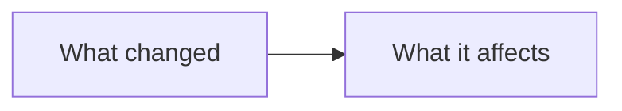

## TLDR

<!-- 2 or 3 lines. What changed, and why. -->

## Changes

<!-- Bullets. One fact each. -->

-
-

## Screenshots

<!-- Required when a player can see the change. Before and after when the pixels changed.

Capture:

    npm run shots
    npm run shots -- --baseline <git-ref> --slug <name>

That writes `pr-shots/head/` (and `pr-shots/baseline/` with the same filenames).
`--slug` copies them to `docs/pr-assets/<name>/`. Commit those files, then
`npm run shots -- --links <name>` prints ready-to-paste markdown.

Embed each png with an absolute raw URL pinned to the full commit SHA. A branch
name in that URL breaks when the branch is deleted after merge, and it changes
if the branch is force-pushed. A relative path resolves against `main` and does
not render on a PR into `v2`. A CI artifact zip does not render inline either.

    

`SHA` is 40 hex characters from `git rev-parse HEAD` after the asset commit.
The walk clip (`level-1-walk.webm`) plays inline only as a GitHub attachment
(drag it onto the body). The `--links` line for the webm is a download link.

Delete this section when nothing visible changed.
-->

## Diagram

<!-- Required when the change touches architecture, data flow, or a state machine.
Delete this section otherwise. One fence is enough:

-->

## Review

- [ ] `npm run ci` passes locally
- [ ] Every commit has a DCO `Signed-off-by:` trailer (`git commit -s`)
- [ ] No raw art added to `public/`; new heavy files went to `art-source/`
- [ ] Docs updated where behaviour changed
- [ ] Visible changes have screenshots or a clip, embedded so GitHub renders them
- [ ] Architecture, data flow, or state-machine changes include a mermaid diagram

## DCO

`git commit -s` adds the `Signed-off-by:` trailer. A local unsigned commit can be fixed with `git commit --amend -s`. Do not force-push to rewrite a commit that is already on the remote.
