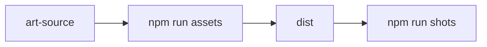

# Agent notes

BatoMan v2. Before changing game code, read [.claude/skills/three-dev/SKILL.md](.claude/skills/three-dev/SKILL.md). Before testing it in a browser, read [.claude/skills/game-testing/SKILL.md](.claude/skills/game-testing/SKILL.md). Pull request text follows the rules on this page. The GitHub template is [.github/pull_request_template.md](.github/pull_request_template.md).

## PR description

Every PR body, from a person or an agent:

1. The first text is a TLDR of 2 or 3 lines: what changed and why.
2. After the TLDR, write bullets. One fact each.
3. Anything a player can see has a screenshot or a short clip. When the pixels changed, show before and after.
4. A change to architecture, data flow, or a state machine has one `mermaid` fence. A copy, config, or test-only edit that leaves those alone has no diagram.

### Screenshots

Run `npm run shots` from the repo root. It builds `dist/`, serves it, and writes:

| File | Scene |
|---|---|
| `pr-shots/head/title.png` | Title |
| `pr-shots/head/level-1-start.png` | Level 1 spawn, idle |
| `pr-shots/head/level-1-mid.png` | Level 1 after 160 ticks of running right |
| `pr-shots/head/editor.png` | Level editor |
| `pr-shots/head/level-1-walk.webm` | The same 160-tick run, as a clip |

`pr-shots/` is gitignored.

```bash
npm run shots -- --baseline v2
```

The same filenames land in `pr-shots/baseline/`. Both captures use a 1280×720 viewport and SwiftShader, one page at a time, and the tick schedule in `tools/shots/plan.ts`. Pass `--slug <name>` to copy them into `docs/pr-assets/<name>/`, with baseline files named `*-before.png`. Commit that folder. Leave `pr-shots/` untracked.

Checkable:

- Gameplay stills open with `?lockstep=1&ticksPerFrame=0`. When `window.__batoman.advance` exists, the script calls `advance(160)` for the mid frame and `advance(8)` for the spawn. When it does not, those flags are ignored and the same inputs are replayed on the production clock. The script must keep working if `advance` is absent.
- Open PR #27 (`infra/e2e-deterministic`) is the change that adds `advance`. Do not import its files and do not wait on it. Once it has merged, `advance` removes the last few ticks of overshoot, so enemy phase matches across machines. Until then, a pair captured by one `npm run shots -- --baseline <ref>` command still lines up: both sides use the replay, and the mid frame stays before the first enemy shot (tick 172) even if a frame steps the maximum 8 ticks past 160.
- The clip has no lockstep query. It keeps using the production clock so the video shows the run.
- `manifest.json` next to the shots records `mode` (`advance` or `replay`), `simTicks`, and `playerX`. Compare a pair only when both sides report the same `mode`.

### Embedding so GitHub renders the picture

Commit the pngs under `docs/pr-assets/<slug>/`. In the PR body, use an absolute raw URL pinned to the full 40-character commit SHA that contains those files:

```markdown

```

That object stays available after the branch is deleted, and a force-push does not move it. A branch name in the same position breaks on delete and shifts on force-push.

`npm run shots -- --slug <name>` copies the files and, when they are not in HEAD yet, prints this two-step flow instead of a URL:

1. `git add docs/pr-assets/<name> && git commit -s`
2. `npm run shots -- --links <name>`

Step 2 prints ready-to-paste markdown using `git rev-parse HEAD`. Run it only after that commit. The webm line is a download link. Inline playback still needs a GitHub attachment (drag the file onto the body).

A relative path such as `docs/pr-assets/<slug>/level-1-mid.png` does not render in a PR body. GitHub resolves it against the default branch, `main`, and PRs here target `v2`.

The `e2e-screenshots` CI artifact is a zip download. It does not render in the body. Keep using it as the test log. PR pictures are the committed files.

A `webm` plays inline only as a GitHub attachment: drag the file onto the body. A raw URL of the video is a download link. Cursor cloud agents can also cite an absolute `/opt/cursor/artifacts/<file>.webm` path inside `<video src="..."></video>` in the PR body; the PR tool uploads it and rewrites the path.

### Mermaid

Required when the diff changes how systems connect, how data moves, or which states a machine can enter. One fenced `mermaid` block. Skip it when the diff is copy, config, or tests that do not change those.

### Minimal example

```markdown
The title and the Level 1 spawn now use the dressed docks, so the first screen matches the art direction.

- Rebuilt the title backdrop and the Level 1 spawn view.
- No sim or control changes.



```

The image paths in that fence are the shape of the URL. Replace the SHA, `example`, and the filenames with the commit, slug, and files from `npm run shots -- --links <name>`.
