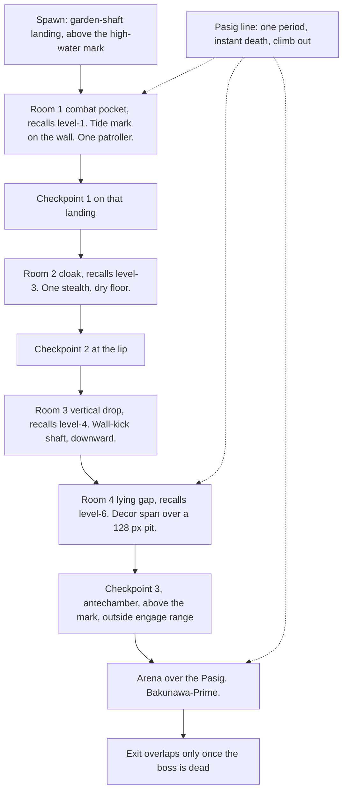

# Finale — Destroyed City Block (`level-5`)

**Status:** Plan only. Nothing in this document adds a level, an atlas, a track, or a boss to the tree.
**Decision (Andre, 20 Nov 2026, [#51](https://github.com/kzap/batoman-game/issues/51)):** "Build the Level 5 finale now as part of finishing the levels."
**Caps (Andre, same day, [#53](https://github.com/kzap/batoman-game/issues/53)):** 900 KB code and 12 MB served stay in `tools/config.ts`. Compression and reuse come first. A raise happens only in the PR that actually overflows, or in a dedicated PR stacked with it, and that PR states the new number, the `npm run budget` line, and the commit it was measured on. This plan does not edit the caps.
**Companions:** [VISION.md](VISION.md), [STORY.md](STORY.md), [PRD.md](PRD.md), [ART.md](ART.md), [TDD.md](TDD.md).

The district is the three blocks the prototype leveled, the Pasig in the street, and Bakunawa-Prime. Story order 5. Challenge: gauntlet. No new verb ([VISION.md](VISION.md) "Rules" and "5 — Destroyed City Block").

---

## 1. Manifest

`src/content/manifest.json` today, in play order:

| Order in the file | id | file | music |
|---|---|---|---|
| 1 | `level-1` | `levels/level-1.json` | `level-1` ("Tondo Sublevel") |
| 2 | `level-3` | `levels/level-3.json` | `level-2` ("Divisoria") |
| 3 | `level-4` | `levels/level-4.json` | `level-2` |
| 4 | `level-6` | `levels/level-6.json` | `level-1` |

The first implementation PR appends one object after `level-6`. It does not rename `level-1`, `level-3`, `level-4`, or `level-6`. A rename that lands before this file exists would point `level-3` at the chapel on disk and at the tower in the story ([VISION.md](VISION.md) "Numbers", [PRD.md](PRD.md) "The five levels"). The later rename to a 1…5 story order is a separate content PR, after `level-5` is in the tree.

`tools/validate` requires the level file's `id` to match the manifest id, and `music` to name a track in `art-source/audio/music.json`. That file has two tracks, `level-1` and `level-2`. Until the music PR, the new entry uses `level-1`, the same stand-in `level-6` already uses.

```json
{
  "id": "level-5",
  "file": "levels/level-5.json",
  "name": "Destroyed City Block",
  "music": "level-1"
}
```

Level JSON is emitted as a static asset, so the file sits in the served total and outside the JS budget ([TDD.md](TDD.md) §8).

---

## 2. Layout

He has already dropped out of the garden shaft. Spawn is that landing. Four short rooms follow, in this order, then the arena. Each room is about one camera width (`CAMERA.viewW` 672 in `src/game/tuning.ts`) to two, not a second copy of `level-1`'s 6400 px docks. The shaft in room 3 is a short drop, not a second `level-4` (1600×1664).

Y is up, as in the other level files. The high street holds the spawn, the combat pocket, and the cloak. The shaft drops to the river street, where the lying gap and the arena sit over the Pasig.

| Room | Recalls | What the earlier level already is | What this room keeps |
|---|---|---|---|
| 1. Combat pocket | `level-1` combat | `src/content/levels/level-1.json`: patrollers, a 672 px last floor (`x: 5728`, `w: 672`), the `aswang` at 6150. Shipped patroller walks and fires straight (`src/game/enemies/patroller.ts`). | One `patroller` on the high landing. Stock type from `spawnEnemy`. The burst-firing patroller in [VISION.md](VISION.md) is still a proposal for the docks, so this room does not wait on it. |
| 2. Cloak | `level-3` stealth | `src/content/levels/level-3.json`: a `stealth` at `(800, 448)`, a static flood pit, a crusher. `src/game/enemies/stealth.ts`: cloaked and unhittable until `ambushRange` 200, `decloakTicks` 40, same storey only (`sightHeight` 128). | One `stealth` in a short dry corridor. The crusher and the chapel's flood pit stay in Quiapo. |
| 3. Vertical drop | `level-4` climb | `src/content/levels/level-4.json`: one-way rungs, a hanging lift (`y` 432→816), a wall-jump shaft against the tower. Wall kick is the path ([VISION.md](VISION.md) tower section). | The same kit, downward: a pair of walls and one-way landings. No new enemy. A drone on another storey would not see him (`sightHeight`), which is the tower's rule, and this room does not need that fight. |
| 4. Lying gap | `level-6` traversal | `src/content/levels/level-6.json`: the 128 px pit at `x: 1248`, `w: 128`, between the roofs that end at 1248 and start at 1376. The painted lying path is not a collider ([TDD.md](TDD.md) §8). A 128 px gap needs a dash at the apex; a full jump rises about 81 px and a plain jump covers a 96 px gap ([TDD.md](TDD.md) §8.1). | A span that reads as floor and is only decor. Under it, a death zone in the 128 px family. The solid landing beyond is the true floor. |
| Arena | The gauntlet, over the Pasig | `level-1`'s last segment is the size reference: one screen, boss between the player and the exit. | Platforms above the high-water mark. Bakunawa's spawn is the boss PR. The exit rect sits past the head. |

Proposed unlocks in [VISION.md](VISION.md) (double jump from the garden, nova overcharge, the HP Up in the shaft) are not required to clear. The grey-box is solvable with the shipped kit: variable jump, wall kick, dash, one-ways.

### Rising water

Folded from the floodgates ([PRD.md](PRD.md) "Folded from the cut districts", [VISION.md](VISION.md) appendix). The line kills when it covers him. He climbs out. Swimming is out of scope ([PRD.md](PRD.md) "Out of scope").

Today a death zone is a static rect. `level-3.json` has one under the stepping stones (`x: 1024`, `y: 320`, `w: 576`, `h: 96`). `World.checkZones` in `src/game/world.ts` treats any overlap, and a body with `top < 0`, as `die('pit')`. There is no water volume and no swim flag.

The finale adds one moving death volume: a rect whose top follows a period. The grey-box may block the low street with a static zone first so the climb is testable, and the moving top replaces that stand-in before `content/level-5` merges. A static pit labeled as a tide is not the lesson.

The period is taught in room 1, on a tide mark, with a landing already above it ([VISION.md](VISION.md) challenge paragraph):

- The mark is on the fallen wall, above the water he can see at the low point of the period.
- Spawn and the combat landing are already above the mark, so the first rise is something he watches.
- From that landing he sees one full rise to the mark and one fall before a lower street is the way on.
- The same period runs in room 4 and in the arena. Rooms 2 and 3 keep their floors above the mark; the line is visible, and the path does not ask him to stand in it.
- In the arena the platforms he fights from stay above the mark at the high point. A platform the coil gives him that then drops through the line is a hazard, the same way a mover can already carry him into a pit.

The period length is tuning for the layout PR, not a number this plan invents. The constraint is the one above: one rise and one fall, readable, from the spawn landing.

### Checkpoints

`World.checkZones` sets the respawn to `{ x: checkpoint.x + w/2, y: checkpoint.y }` and a death rebuilds every enemy (`tests/unit/game/enemies.test.ts`, "a player death respawns every enemy fresh, boss included"). Each checkpoint rect sits on a solid that stays above the high-water mark, so a water death does not put him back in the line.

| id | Where | Why |
|---|---|---|
| 1 | Room 1's high landing, after the patroller | The tide lesson sticks. A later death does not replay it. |
| 2 | The lip, before the shaft | A missed wall-kick returns to the lip, not to the cloak. |
| 3 | The antechamber, on the river street, above the mark | The fight returns here. Place it more than `BOSS.engageRange` (560 px, `src/game/tuning.ts`) from the boss spawn. On `level-1` checkpoint 2 is at `x: 5024` and the aswang is at `x: 6150` (1126 px), which is the same idea. |

No checkpoint on a floor the line covers.

### Flow



---

## 3. Bakunawa-Prime

Canon final boss ([STORY.md](STORY.md) unit table, [ART.md](ART.md) "Bakunawa-Prime"). It tests survival: memory plus the water clock ([VISION.md](VISION.md)). Three phases. The moon-glyph on the forehead is the core. It pulses magenta `#ff2d78` with a white `#ffffff` diamond outline while the window is open, the shipped weak-point rule ([ART.md](ART.md) visual-language rule 3). Reduce-motion holds the fill steady.

Starting hp curve copies the prototype, so the route's phase thirds stay familiar: `BOSS.hp` 24, `BOSS.phaseHp` `[16, 8]` in `src/game/tuning.ts`. A playtest can lengthen it. This plan does not invent a second curve.

The hanging-metal opener is an open question in §5. The windows below work if Andre leaves the metal as dressing. If he makes the metal the key, the same 100-tick window starts when the piece is shot, and a bell in the approach teaches it. The layout PR does not build that key.

Hull shots do not advance hp. [ART.md](ART.md) names the glyph as the vulnerable state. That is stricter than the prototype, which still takes body damage and only doubles on the core (`Boss.damageFor` in `src/game/enemies/boss.ts`). Bakunawa takes the prototype's weak-point multiplier (`BOSS.weakPointMultiplier` 2) and only during the open window.

`hittable` is false while dormant and during the phase shift, matching `Boss.hittable`. `BOSS.phaseShiftTicks` is 72. Contact still hurts the player.

### Phases

**Phase 1 — the head from the water.** Head and neck only ([ART.md](ART.md): head 192×128). The head commits a bite, then holds. The glyph is open for `BOSS.stunTicks` (100 ticks, 120 Hz, about 0.83 s). A nova charge is 0.8 s ([PRD.md](PRD.md)), and `bossFight()` in `tests/replay/route.ts` already holds fire for a nova during the prototype's stun. The window stays at least 100 ticks so that nova fits. Between bites the glyph is closed.

**Phase 2 — the body constricts.** Coils use the tiled 96×96 segment ([ART.md](ART.md)), so the sheet stores one segment. Platforms, which are moving solids the schema already has, become the hazard. The water line is the clock, the same period as room 1. The glyph opens for 100 ticks when a coil finishes and the head is committed, and the hold is aimed at a platform that is above the mark for the whole window. A stance the line is about to cover is not a punish.

**Phase 3 — no new tell.** Four tells, each one a boss he has already beaten. Nothing else.

| Tell in phase 3 | Earlier boss | Where that tell is written | Hit window on Bakunawa |
|---|---|---|---|
| Rush | ASWANG prototype | Shipped. `src/game/enemies/boss.ts`: `rushWindup` (`BOSS.rushWindupTicks` 40) → `rush` (collider drops to `BOSS.rushHeight` 56 so a jump clears it, `rushMaxTicks` 90) → `stunned` for `BOSS.stunTicks` 100, core doubles. | The same rush. Glyph open for those 100 stun ticks. Closed during the windup and the charge. |
| Blindness | Sigbin Unit | [ART.md](ART.md): active camo, only a ripple until it is close. [VISION.md](VISION.md): lunges from behind, dorsal core opens on the recovery. The chapel scout (`stealth.ts`) is the shipped cloak the player has already met; the unit itself is not built (#41). | Glyph stays closed while the body is only a ripple, including the lunge. It opens on the recovery, the sigbin's punish, for 100 ticks. |
| Fake position | Tikbalang-X | [VISION.md](VISION.md): the afterimage takes no damage; the solid body stumbles and the weak point opens. The scout in `src/game/enemies/tikbalang.ts` is a different actor (burst and stomp). The boss tell is the horse's, and it is #49. | Shots on the afterimage do nothing. Glyph opens on the solid body's stumble, for 100 ticks. |
| Second body | Manananggal-7 | [VISION.md](VISION.md), confirmed by Andre for `level-4`: the flyer comes back while the half on the balcony lives. [ART.md](ART.md): lower-half conduit, upper-half chest panel. Not built (#50). | Hits on the flying half do not advance hp. The planted half's conduit is the window until that half is dead. Then the flyer is the body that remains, and its chest panel uses the same 100-tick window. |

Phase 3 may sequence those four. It may not add a projectile pattern, a grab, a new weak point, or a fifth cadence.

### Exit gating

`World.exitOpen` (`src/game/world.ts`) is true only when `boss === null || !boss.alive`. `checkZones` completes the level on an exit overlap only when that is true. On `level-1` the exit is the column at `x: 6336`, past the aswang at `x: 6150`, and the TDD states the exit stays shut until the boss dies.

For `level-5`:

- The exit rect is past the head, above the high-water mark. Walking to it crosses the engage range, so the bar is up before the door is reachable. Engage uses the prototype's 560 px as the starting range (`BOSS.engageRange`); dormant until then, HUD bar at the same moment (`Boss.engaged`).
- Alive includes dormant and the shift. The door stays shut through both.
- A water death respawns at checkpoint 3 and rebuilds the boss at full hp, phase 1, dormant until he walks back into range.
- The grey-box PR ships with no boss spawn. `exitOpen` is then true because `boss === null`, which is how `level-4` clears today ([TDD.md](TDD.md) §8, [#52](https://github.com/kzap/batoman-game/issues/52)). That is temporary. `phase/9-bakunawa-boss` adds the spawn, and the clear fixture fails if the boss is still alive.

The new enemy type is not `aswang`. `spawnEnemy` (`src/game/enemies/index.ts`) maps `aswang` to the prototype class. Bakunawa is its own type string, added in the boss PR, and `levelProblems` has to accept it.

Winning the level uses the results card the shell already has. The portrait and the grow-light are the questions in §5, not a second fight and not a second health bar.

---

## 4. Art and music

Look is [ART.md](ART.md) "Level 10 — Destroyed City Block", read with the hour in [VISION.md](VISION.md): dusk over the Pasig, ash, fire, the river's blue-green, blood magenta. The rubble carries the other four lights (golden dock timber, candle stone, a sunset-tower shard in NSA cyan, sun on a vine). It is not the docks' night neon, and it is not a second chapel. A level has one prop atlas ([TDD.md](TDD.md) §8), so those four lights are painted into the backdrops. They are not four extra atlases.

Bakunawa: submarine-black hull, bioluminescent blue marks, head 192×128, body segments tiled 96×96, glyph as the core ([ART.md](ART.md)).

### New versus reused

| Piece | | Notes |
|---|---|---|
| Patroller, drone, stealth sheets | Reused | Already packed. Room 1 and room 2 spawn those types. |
| `tikbalang` atlas (447,618 bytes WebP, [#53](https://github.com/kzap/batoman-game/issues/53)) | Reused elsewhere | The horse stays on `level-6`. Phase 3's fake position is Bakunawa's own posing, not a second spawn of that sheet. |
| `level-1` ogg, "Tondo Sublevel", 1.92 MB | Reused as the stand-in | Manifest `music` until the cue exists. [TDD.md](TDD.md) §7.5: 191 s at 80 kbps. |
| `src/content/levels/level-5.json` | New, small | Static asset, outside the JS budget. |
| Moving death volume | New code | `content/level-5`. One rect with a moving top. |
| Boss type and phase machine | New code | `phase/9-bakunawa-boss`. |
| Far backdrop, dusk | New | `art-source/level-5/`. |
| Mid backdrop, the block | New | Hanging infrastructure, fires, the river under the street. |
| `level-5-props` | New, kept short | Tide-mark dressing, rubble that is not already a backdrop, and the hanging pieces if §5 approves them as a mechanic. |
| Bakunawa sheet | New | Head plus one tiled segment, phase poses, glyph frames. |
| Finale cue | New | Pans and kulintang over the Tondo bass ([VISION.md](VISION.md)). On the kill: one chord, then the docks theme at half density. Author that reprise as the tail of this file so the manifest still names one track. A second 1.92 MB ogg is the outcome to avoid. |
| Epal portrait | Not in the first art PR | [ART.md](ART.md) allows a cutscene portrait and no playable sprite. Bytes wait on §5. |

### First-pass bytes

Caps in `tools/config.ts`: served `12 * 1024 * 1024`, code `900 * 1024`, single image `1.5 * 1024 * 1024`, single audio `6 * 1024 * 1024`. Both WebP and KTX2 count, because `dist/` carries every file ([TDD.md](TDD.md) §7.4). Far backdrops already pack a smaller LOD; the mid layer stays full resolution.

This branch does not run `npm run budget`. The neighborhood is the one [#53](https://github.com/kzap/batoman-game/issues/53) recorded:

- Code **840.0 KB / 900 KB** on PR #46. #53 forecast #40 at +5.9 KB and #41 at +5.4 KB, leaving about 49 KB. Tip `e9d3a81` is the #40 results card, so part of that forecast is already on `v2`.
- Served **10.93 MB / 12 MB** on the #46 worktree (about 1.07 MB of room). #45's sigbin atlas is **864.6 KB**, and that PR's pre-diet served total was **11.72 MB**, after which #53 calls the remaining room a few hundred KB. Treat 10.93 MB as the neighborhood, not a new count of `e9d3a81`.

| Addition | Analogue | First pass |
|---|---|---|
| Boss plus the moving line, minified | #41 forecast +5.4 KB | +5 to +15 KB of JS until a build measures it |
| Bakunawa WebP | Sigbin atlas 864.6 KB (#45) | ~850 KB. One tiled segment, not a frame per coil. Must stay under the 1.5 MB image cap. |
| `level-5-props` WebP | Level 6 atlas 636 KB ([PLAN.md](PLAN.md)); `level-4-props` 791 KB ([TDD.md](TDD.md) §7.4) | ~300 KB. Matching those atlases is the cut to refuse. |
| Far WebP + KTX2 | Level 1 `sky` 35 / 66 KB; Level 6 `sky` 104 KB | ~80 + ~80 KB |
| Mid WebP + KTX2 | Level 6 `garden` 378 KB; Level 4 `street` 166 / 412 KB | ~300 + ~350 KB |
| Cue at 80 kbps | Level 2, 60 s, 620 KB. Level 1, 191 s, 1.92 MB. | ~620 KB. The 6 MB audio cap is not the constraint. |

Art plus the short cue is about 850 + 300 + 160 + 650 + 620 = **2580 KB, about 2.5 MB**, on top of a remaining **0.3 to 1.1 MB**. The dressed finale does not fit the 12 MB cap on these analogues.

Cuts to try before any raise, in the art and music PRs ([#53](https://github.com/kzap/batoman-game/issues/53), Andre: compression and reuse first):

- Keep the cue at the 60 s / ~620 KB size. A Tondo-length file is ~1.3 MB of extra weight and is the wrong first move.
- Hold the props atlas near 300 KB, not 636–791.
- Keep the body segment tiled.
- Let the far plate use the existing far LOD. Do not add a second copy of the Level 1–6 atlases.

### Where a stated cap-raise PR may be needed

- **`art/level-5` (served).** Likely. A Bakunawa sheet near the sigbin atlas, plus the mid WebP/KTX2 pair, is already around 1.9 MB before props and music. If `npm run budget` on that PR is over 12 MB after the cuts above, that PR or a dedicated one stacked with it raises `totalServed` and states the measured bytes and the commit. It does not raise the code cap.
- **`content/level-5-music` (served).** If the art PR fitted only by leaving the `level-1` stand-in in place, the cue is the file that overflows. The music PR then states the raise. If the cue can be the short loop and the served line still passes, no raise.
- **`content/level-5` and `phase/9-bakunawa-boss` (code).** Unlikely at +5 to +15 KB against the ~49 KB neighborhood, and not something to spend in advance. If Sigbin, Tikbalang-X, and Manananggal-7 land first and the code line is within ~15 KB of 900, the boss PR measures again. A code raise is stated only when that build's code line exceeds 900 KB.
- **Single image and single audio.** The analogues sit under 1.5 MB and under 6 MB. A raise of those two is not the expected outcome. A sheet that blows the 1.5 MB image cap gets cut or split before anyone touches `singleImage`.

`tools/config.ts` stays as it is in every PR that still fits.

---

## 5. Open questions for Andre

These are still marked **proposal** in [VISION.md](VISION.md), [STORY.md](STORY.md), and [PRD.md](PRD.md). This plan does not approve them. VISION's ending paragraph says the portrait and the grow-light were "not re-asked as a puzzle"; they are asked here because they are still proposals, and [#51](https://github.com/kzap/batoman-game/issues/51) says not to treat them as decided.

1. **Epal portrait behind glass.** [STORY.md](STORY.md) and [VISION.md](VISION.md): his face arrives in the finale as the portrait [ART.md](ART.md) already allows (clinical coat, the smile), a sealed gallery, no second health bar. [PRD.md](PRD.md) "Win / lose" is the same proposal. Does the confrontation stay a portrait and text after Bakunawa falls?
2. **The grow-light ending.** Same paragraphs: the NSA is still the government, one grow-light comes back on in the ruined roofs, the garden is not restored and is no longer hidden. Is that the last card?
3. **The hanging-metal glyph.** [VISION.md](VISION.md) phase 1: shooting a pan, a kulintang bar, or a jeepney panel is what opens the glyph, taught on a bell in the approach. [ART.md](ART.md) opens the glyph on the hit window with no metal key. Does the metal open the window, or is it dressing? §3 is written so the fight ships either way. The room-1 hint beside it (the glyph scored dark on that wall, a coil shifting once, pans ringing with nobody touching them) stays a proposal with this question. The tide mark itself is the lesson in §2 and does not wait on the answer.

---

## 6. Implementation

One phase each. Branches off `v2`, PRs targeting `v2`. Parallel with #49 (Tikbalang-X) and #50 (Manananggal-7) is fine. The boss PR merges last, because phase 3 only repeats tells those fights have already taught ([#51](https://github.com/kzap/batoman-game/issues/51) comment).

`PLAN.md` uses "Phase 9" for the later `v2` → `main` merge (issue #22). The branch `phase/9-bakunawa-boss` is this boss. It is not that merge.

### `content/level-5` — Rio

Layout, grey-box first. `src/content/levels/level-5.json`, the manifest append in §1, and the moving death volume. No `art` block, no `art-source/level-5/`, no Bakunawa spawn, no rename, no cap edit.

Acceptance:

- [ ] Manifest order is `level-1`, `level-3`, `level-4`, `level-6`, `level-5`. Existing ids, files, names, and music are unchanged. The new `music` is `level-1`. The level file's `id` is `level-5`.
- [ ] Rooms run in order: combat pocket, cloak, vertical drop, lying gap, then the arena footprint. Each room cites the recall in §2, including a 128 px-family lying gap and a downward wall-kick shaft.
- [ ] Spawn and checkpoints 1–3 sit above the high-water mark. Checkpoint 3 is more than 560 px from where the boss will stand. No checkpoint on a floor the line covers.
- [ ] Room 1 shows one full rise to the tide mark and one fall from the spawn landing. Overlap with the line calls `die('pit')`. There is no swim state.
- [ ] The clear uses the shipped kit. A recorded `level-5-clear` fixture completes. With no boss spawn, the exit opens, and the PR says so.
- [ ] `npm run ci` is green. `npm run budget` still fits both caps, or this PR is the one that states a raise. A JSON file and one small actor are not expected to need one.

### `art/level-5` — Sining

Backdrops, the short props atlas, the Bakunawa sheet, and the `art` block on the level. After `content/level-5`, so the block has a file to land in. Raw files stay in `art-source/level-5/`. Nothing raw under `public/`.

Acceptance:

- [ ] Far and mid plates match the Level 10 row and the dusk hour in §4. The four borrowed lights are in the paintings.
- [ ] The sheet is the ART silhouette: 192×128 head, tiled 96×96 segment, black hull, blue marks, magenta glyph with a white diamond outline.
- [ ] Enemy sheets are not repacked. Props stay a short atlas, aimed at ~300 KB rather than the Level 4 or Level 6 prop atlases.
- [ ] The PR pastes `npm run budget` for its commit. Over 12 MB after the §4 cuts, it states a `totalServed` raise or stacks a dedicated raise PR. A single image over 1.5 MB is cut or split instead.
- [ ] `npm run ci` is green. Quinn's #52 note covers the new plates (below).

### `content/level-5-music` — Sining

One new track in `art-source/audio/music.json`, packed to `public/assets/audio/<id>.ogg` at the spec bitrate (80 kbps). The manifest `music` for `level-5` retargets off `level-1`. The half-density docks reprise is the tail of this file.

Acceptance:

- [ ] `npm run validate` accepts the track id. The level plays it, and the title track is unchanged.
- [ ] The loop is about a minute, in the 620 KB neighborhood of the Level 2 cue, not a second 1.92 MB Tondo file.
- [ ] The PR pastes `npm run budget`. If this file is what crosses 12 MB, the PR states the served raise. If the short loop fits, the caps stay.
- [ ] `npm run ci` is green.

### `phase/9-bakunawa-boss` — Rio

The boss type, the three phases in §3, the exit gate. Merges after #41, #49, and #50 so phase 3 is a recall. Work on the branch can start earlier.

Acceptance:

- [ ] A new spawn type, not `aswang`. Phase 1 is the head and the glyph. Phase 2 constricts and uses the same water period. Phase 3 uses only the four tells in the §3 table (ASWANG prototype, Sigbin Unit, Tikbalang-X, Manananggal-7) and adds no tell of its own.
- [ ] Windows match §3: glyph only, multiplier 2, at least 100 ticks, shift and dormant unhittable. Hull shots do not advance hp.
- [ ] The exit stays shut while the boss is alive, dormant and shift included. A death at checkpoint 3 restores a full phase-1 boss. The clear fixture fails if the boss is left alive.
- [ ] Unit coverage sits with `tests/unit/game/enemies.test.ts`. No portrait, no grow-light, no hanging-metal key, unless Andre has answered §5 in writing.
- [ ] `npm run budget` is in the PR. A code raise is stated only if the code line exceeds 900 KB.
- [ ] `npm run ci` is green.

### QA — Quinn, under [#52](https://github.com/kzap/batoman-game/issues/52)

No new issue. #52 already lists the finale PRs as later triggers. Quinn's notes land on these PRs, or on a small `qa/level-5-fixtures` branch when the author PR has merged.

Acceptance, for each of the four PRs above that changes what a player does or sees:

- [ ] Quinn plays the hosted build or the PR preview and posts what broke, what held, and whether the exit gate matches the PR (open in the grey-box, shut once the spawn exists).
- [ ] `level-5-clear` is re-recorded when the route or the gate changes. Other levels' fixtures still pass.
- [ ] E2E screenshots cover the tide mark, the four rooms, and the arena once those exist, and they assert the atlases and backdrops once `art/level-5` has them.
- [ ] `npm run ci` is green on the PR that carries the fixture refresh.

---

## Out of this plan

No `src/content/levels/level-5.json`, no manifest edit, no `art-source/level-5/`, no boss class, and no change to `tools/config.ts` in the planning PR. Those are the issues in §6.
