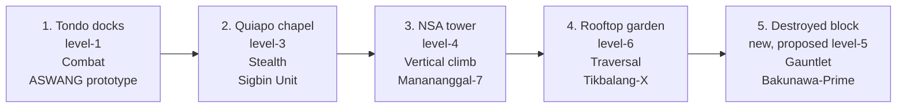

# BatoMan — Full-Game Vision

**Status:** Revised after Andre's review. Still a proposal until he closes the questions at the end.
**Direction taken:** Five levels, not ten. Every level has a boss that fits its theme, including the tower. Each level is a different kind of challenge. Dropped districts move to the appendix, and the best of them is folded into the five.
**Scope of this document:** The plan. It does not change code, levels, or art.
**Companions:** [STORY.md](STORY.md) (who and why), [PRD.md](PRD.md) (requirements and the v0.2 flag), [ART.md](ART.md) (look and palette), [TDD.md](TDD.md) (what the remake actually runs).

**Canon** is already in those docs or in the v2 build. **Proposal** is invented here to close a gap. Andre's review is marked **direction**.

---

## Why these five

The game already has four districts, and the story only needs one more place: the blocks where it started, on the morning it ends.

Ando does not begin as a man with a map. An NSA machine erased three blocks of Tondo, including the rooftop garden his father rebuilt, and that machine is still on the docks. Level 1 is the fight that proves a unit can fall. It has to be first, and it has to be combat, because that is the only question he is asking.

What he does not know yet is that the machine has a name. The people on the docks still keep paper. The only archive the NSA did not index is under Quiapo. Level 3, the chapel, is the second level because it is where a street fight becomes Project ASWANG. The grey-box is already a dark, flooded, cloaked place, and the concept painting already puts the Sigbin in the nave. That is the stealth level. Putting it after the tower would send him up the glass before he knows why.

The list names the tower as the eye. Level 4 is already the only vertical level in the game, and it is already dressed. It is the third level because the climb is how he gets high enough to see the garden, and because the boss that fits this face of the city — Manananggal-7, whose own sheet has an NSA tower in the background — can only be killed by using the shaft. The climb is the challenge. The old bossless reading is retired by direction. The hangar stealth-fighter sheet stays unused: it is a horizontal airport fight, a different level.

The garden is the fourth level, not the second. It is the personal center, and it should land after he has a reason to come home. Tikbalang-X has done what tikbalang do: bent the paths so the farmers could not find their way back. The grey-box is already heights, a dash gap, and a lift. That is the traversal level. The boss lies about where the floor is. When it falls, one room under a planter holds what used to be a whole laboratory level: the name Bakunawa-Prime, and the three blocks as the place it will rise.

Those three blocks cannot be any of the four levels we have. The docks are the start, the chapel is underground, the tower is the climb, the garden is the homecoming. The ending is the street at river level, the Pasig on a clock, and a last fight that remembers the other four. That is the fifth level, and it is new. Its challenge is the gauntlet.

Dropped from the walk, not from the world: Divisoria, the skyway, Laboratoryo Zero as its own level, the floodgates, and the arcology. What they were for is folded in below, and the rest is in the appendix.

## Numbers

Story order is 1 through 5. The content ids in the repo are not those numbers. This document does not rename files. `manifest.json` stays `level-1`, `level-3`, `level-4`, `level-6` until a later content PR. The finale has no file yet.

| Story order | District | Current content id | Proposed id, later | Challenge | Boss |
|---|---|---|---|---|---|
| 1 | Tondo Sublevel Docks | `level-1` | `level-1` | Combat | ASWANG prototype (shipped) |
| 2 | Quiapo Underground Chapel | `level-3` | `level-2` | Stealth | Sigbin Unit (not built) |
| 3 | NSA Tower Exterior | `level-4` | `level-3` | Vertical climb | Manananggal-7 (proposal; not built) |
| 4 | Abandoned Rooftop Garden | `level-6` | `level-4` | Traversal | Tikbalang-X (spawn only) |
| 5 | Destroyed City Block | none | `level-5` | Gauntlet | Bakunawa-Prime (not built) |

A rename that lands before the finale exists would point `level-3` at the chapel in the files and at the tower in the story. Do not rename until the mapping above is the whole set.

## What the build actually is

Verified on `v2` against `src/content`, `src/game/enemies`, and `art-source/`:

| Content id | State | Boss today |
|---|---|---|
| `level-1` | Dressed, 6400×768. Patrollers and drones. | ASWANG prototype, playable. Bursts, a rush that ends stunned with the weak point open, then drones. HUD: "ASWANG PROTOTYPE". |
| `level-3` | Grey-box, 3584×1024. One stealth, one drone, one patroller. Crusher, spikes, flood pit, one-way shaft. One concept painting. | None placed. PRD, ART, and the painting name the Sigbin Unit. |
| `level-4` | Dressed, 1600×1664, vertical. Patrollers, drones, one stealth. Enemies ignore him on another storey. | None. The exit opens because the sim treats a missing boss as a clear. Direction: this level gets a boss. |
| `level-6` | Grey-box, 4480×896. Drone, patroller, a `tikbalang` spawn at the end. No source art. | The sheet exists (`idle`, `run`, `stomp`, `hurt`, `death`, `projectile`) and the renderer has a look. `spawnEnemy` returns null, so nothing is created and nothing is drawn. |

Shipped kit: variable jump (a full jump is about 81 px; a 128 px gap needs a dash at the apex), coyote time, wall kick, dash with i-frames, crouch-slide, one-ways, movers, spikes, crushers, pits, plasma (tap, 1 damage), nova (hold 0.8 s, a piercing bolt, 3 damage). 3 hearts, 3 lives. No powerups in the sim. The story's wide nova explosion and the "Down + move" salakot dash are the fantasy; the sim pierces, and the dash is Shift / X / K.

Two music files exist. "Tondo Sublevel" plays on `level-1` and `level-6`. "Divisoria" plays on `level-3` and `level-4`. Divisoria is no longer a level. Those shares are stand-ins.

## Rules

**One challenge per level, and the boss is that challenge again.** Combat, stealth, vertical climb, traversal, gauntlet. A boss that introduces a different verb is a draft.

**The level hints at its boss before the arena.** A silhouette, a piece of damage, a sound, a warning, or an enemy that already behaves like the boss. The hint is early enough that the fight feels recognized.

**The myth is stolen.** Civilians still light candles and still make noise when the moon goes dark. An ASWANG unit is the NSA's copy. Saints and the Black Nazarene stay in the alcoves. They are never enemies.

**Three behaviours are the roster.** Patroller, drone, stealth. New work reskins them first. Tikbalang-X needs its own behaviour because the sheet and the spawn are already the garden's boss. Shields, wind, and rising water are small additions folded into a level below, not new districts.

**No boss-weapon copies.** Plasma and nova stay the guns. The short unlock list further down is a proposal.

**Story is the level, plus a portrait and text.** No animated cutscenes, no dialogue system.

---

## The five

### 1 — Tondo Sublevel Docks

**Content id:** `level-1`. **Challenge:** combat. **Theme:** the waterfront, and the aswang as a class before it has a species.

**Story.** Pre-dawn, the prototype still on the piers, three blocks already gone. He kills it. The garden does not come back. Someone at a sari-sari shack tells him the people who still write things down are under Quiapo. That is the whole handoff. Divisoria is no longer a stop.

**What the level already is.** Dash gaps, one-ways, a mover, spikes, patrollers, drones, and a three-phase boss. This is the combat textbook: a telegraph, a rush he jumps, a stun where the weak point doubles damage, then the same duel with drones in the air.

**Boss.** ASWANG prototype (canon, shipped). It tests combat and nothing else. He already met its shots on the patrollers and its air pressure on the drones.

**Early hint (proposal, the level does not have it yet).** The far pier carries a lilac silhouette in the mid backdrop, the same tint the boss uses. One patroller before the arena fires the three-shot burst the boss opens with, so the pattern is heard before it is the whole fight. A stencil on the last intact wall reads like a warning, not a tutorial popup: the prototype is uncontained.

**Folded in.** From Divisoria, one shielded patroller on the approach to the arena: plasma fails on the shield, the nova punches it. The market's whole "nova as a key" lesson becomes one combat beat here, where the challenge is already combat. No stalls, no nuno.

**Music and look.** The existing "Tondo Sublevel" cue stays. Look is ART's Level 1 row: rust, amber, electric-blue water. That row is canon and already on screen.

### 2 — Quiapo Underground Chapel

**Content id:** `level-3`. **Challenge:** stealth. **Theme:** Quiapo devotion, anting-anting, the sigbin in the candlelight.

**Story.** He comes for the rest of the list. The Sigbin Unit was sent because the record-keepers were mapping disappearances on paper. **Proposal:** by candlelight the pages say Project ASWANG, the garden marked cleared, the tower named as the eye. The santos stay in the alcoves. He leaves with the pages, and he leaves upward.

**What the level already is.** A cloaked enemy, a dark nave, a flood pit, a crusher, a one-way shaft. The crusher and the water are pressure. They are not the challenge. The challenge is a threat that is not in front of him until it decides to be.

**Boss.** Sigbin Unit (canon, not placed). **Proposal for the fight:** it lunges from behind, and the dorsal core (ART) opens only on the recovery, the same punish grammar as the prototype's stun, told as stealth instead of as a rush. The PRD's "specific sequence" was never defined; this is that sequence. It does not fly and it does not warp the room.

**Early hint.** The stealth enemy already standing in the grey-box is the hint: same cloak, same "not there until you are close." **Proposal on top of that:** prints in the flood that face the wrong way, and a shimmer at the edge of a candle before the scout decloaks. The concept painting, sigbin in the water under the bridge, is the dressing target for the arena, glimpsed as a reflection earlier in the nave.

**Folded in.** One sealed niche, opened by the nova and not by a tap, holding the list. That is Divisoria's lock, used once, so the stealth level still has a single aimed shot. It is not a market, and it is not the exam.

**Music and look.** **Proposal:** a new cue. The Divisoria track on this level today is the wrong district. Direction: a slow procession drum, candle-crackle, the drum phrase played quietly backwards as the sigbin's tell. Look is ART's Level 3 row: indigo, candle gold, teal water. Dressing waits on source art. The painting is the mood.

### 3 — NSA Tower Exterior

**Content id:** `level-4`. **Challenge:** vertical climb. **Theme:** the institution's face. Searchlights, glass, scaffolds, the logo repeating. The boss is the myth the NSA was willing to bolt onto its own building.

**Story.** He climbs the outside because the list named this tower and no ground-floor door was going to open. **Proposal:** Manananggal-7 is posted on the face. It looks like part of the building until it splits: the lower half holds a balcony, the upper half hunts the shaft. From the roof, after it falls, the dead grow-lights of the garden are visible. He goes home across the roofs. There is no skyway level between them.

**What the level already is.** A dressed vertical climb: rungs, a hanging lift, a wall-jump shaft, enemies that do not aggro across storeys. The wall kick was optional on the docks. Here it is the path.

**Boss.** **Manananggal-7 (proposal for this level).** Canon unit, previously written for the arcology, which is cut. The sheet in `art-source/level-1/concept-art-boss.png` shows the split body — wings, exposed spine, a separate hydraulic lower half — with an NSA tower in the backdrop. That painting is the design reference for this fight, not for the docks. The docks keep the prototype.

The fight tests the climb. Phase 1 is the whole body on a balcony, a duel he has to reach. Phase 2 splits: the upper half owns the air of the shaft, the lower half stays planted on a balcony he already passed. Killing the flyer does not stick; it returns while the lower half lives (the folk rule ART already states: destroy the base first). He has to go back down. Phase 3 is the flyer alone, once the balcony half is gone. Wind in the top shaft, folded from the skyway, shoves jumps only, and only after a telegraph of litter and bending searchlights. Standing on a rung is safe.

**Early hint (proposal).** In the first shaft, a wing shadow crosses the glass on the searchlight sweep. On the second balcony, before any fight, a hydraulic scrape and a dropped cable mark the perch the lower half will use. A status light on the tower face reads like a floor number and is actually a unit number. He has seen the perch before he is asked to go back to it.

**What this is not.** The hangar stealth-fighter sheet in `art-source/level-4/` is a horizontal runway boss. It does not fit this exterior, and this plan does not use it. Sniper mechs from the old PRD row are not added. The tower's roster stays the one already placed, plus the boss.

**Music and look.** **Proposal:** a new cue, sparse, a searchlight pulse, almost no melody, tearing into a low layer and a high layer when the unit splits. Look is ART's Level 4 row, already shipping: cold grey-blue, hard white, black. The boss is the only warm-red flesh-and-plasma shape on that glass, so it reads before it moves.

### 4 — Abandoned Rooftop Garden

**Content id:** `level-6`. **Challenge:** traversal. **Theme:** his father's garden, and the tikbalang that hides the way home.

**Story.** Rain, mutant vines, other farmers' salakot still in the planters (ART). Tikbalang-X bent the paths after the prototype's raid, which is why the garden stayed empty. He breaks the spell in the stumble, then for good. The plants are still dead. **Proposal:** under a collapsed planter the irrigation shaft is a concrete room, not a cistern. One file and one portrait of Epal: Bakunawa-Prime, one night, up the Pasig, into the three blocks. That room is the laboratory. It is not a level. He goes down to the street.

**What the level already is.** Roofs at different heights, a hop, a 128 px dash gap, a vertical lift, a drop, one-way steps, spikes. That is traversal with the kit he has. Crumbling planters stay a possible later pass, in the appendix's sense of "not required to call the challenge true." The grey-box already says it.

**Boss.** Tikbalang-X (canon). **Proposal for the behaviour, on the clips the sheet already has:**

- `run` between points.
- `projectile` for a straight shot, so the duel starts in the docks' language.
- `stomp` as the warp: an afterimage stays, the body is elsewhere. The afterimage takes no damage.
- On landing, `hurt` held as the stumble. Weak point open, same double-damage rule as the prototype.

It tests traversal. The floor he wants to stand on is the lie. The solid landing is the only place the hit counts. He has already crossed a gap that looked shorter than it was.

**Early hint (proposal).** Two roofs in, a vine bridge reads as a path and is a pit. In the rain ahead of him, one afterimage crosses a gap and does not leave footprints. A stomp, offscreen, shakes the planter he is on. The music, when this level has its own cue, detunes on that shake and locks back when he lands true, a second tell for players who cannot read the fake.

**Folded in.** Kapre's smoke becomes one greenhouse roof of fog: he crosses by silhouette and edge, a traversal problem, not a second stealth game. Kapre-9 himself is cut. The lab's files are the room after the boss, portrait and text.

**Music and look.** **Proposal:** the Tondo theme with the drums taken out, one instrument and the rain. Today's playback is the docks track unchanged, which is the right family and the wrong arrangement. Look is ART's Level 6 row: wet green, night blue, one amber grow-light, the abandoned hats. No source art exists yet.

### 5 — Destroyed City Block

**Content id:** none. **Proposed later id:** `level-5`. **Challenge:** gauntlet. **Theme:** the three blocks from the opening, the Pasig in the street, Bakunawa.

**Story.** He drops from the garden's shaft onto the blocks the prototype leveled. The rubble holds the docks, the chapel, the tower, and the garden, which ART's old Level 10 row already asked for. Bakunawa-Prime rises. **Proposal for the ending, unchanged from the previous draft and not re-asked as a puzzle:** Epal is a portrait behind glass, still sure he is necessary. He is not a health bar. When the serpent breaks, the NSA is still the government. One grow-light comes on in the ruined roofs. The garden is not restored. It is no longer hidden.

**Challenge.** No new verb. Four short rooms, in order: a combat pocket, a cloak, a vertical drop, a gap that lies. Then the arena. The Pasig rises on a period he can learn, folded from the floodgates: the line kills if it covers him, and he climbs out. There is no swim. The period is taught on a tide mark in the first room, with a landing already above it.

**Boss.** Bakunawa-Prime (canon). It tests survival, which is memory plus a clock.

- Phase 1: the head from the water. The moon-glyph (ART) is the core. **Proposal:** shooting hanging metal — a pan, a kulintang bar, a jeepney panel — is what opens the glyph, the eclipse noise as a mechanic, taught on a bell in the approach.
- Phase 2: the body constricts and the platforms become the hazard. The water line is the clock from the floodgates, now inside the fight.
- Phase 3: no new tell. A rush, a fake position, a moment of blindness, a second body that does not matter until the first is dead. Every one of those was a boss he has already beaten.

**Early hint (proposal).** Room one has the moon-glyph scored into a fallen wall, dark. A tide mark on the same wall is wet above the water he can see. Something under the street shifts once, a coil, and the pans in the rubble ring without anyone touching them. The hint and the phase-1 attack are the same picture.

**Music and look.** **Proposal:** pans and the series' kulintang over the Tondo bass. When the serpent falls, one chord, then the docks theme at half density under the last card. Look is ART's Level 10 row, which is this level's palette even though the old document numbered it last of ten: ash, fire, Pasig blue-green, magenta. Pre-dawn, so it rhymes with the docks and is later in the night.

### Unlocks (proposal)

A short list, using only powerups the PRD already named. None of them solves the boss of the level that grants it.

| Story level | Unlock |
|---|---|
| 1 Docks | One Armor Shard before the arena. The no-hit clear still stands without it. |
| 2 Chapel | One temporary Invincibility in the trap run. No permanent. |
| 3 Tower | Nothing. The climb is the kit he has. |
| 4 Garden | Double Jump, permanent, when Tikbalang-X falls. The finale is the only level designed for it. |
| 5 Ruins | One temporary Nova Overcharge in the antechamber, and one HP Up found with the files in the garden shaft so the gauntlet allows a mistake. |

---

## v0.2

Said plainly.

**What v0.2 already is, from PLAN.** Dress `level-3` and `level-6` when art exists. Give the tikbalang behaviour. Phase 8 polish: instancing, culling, compression, LOD, remappable input, reduce-motion, colourblind-safe weak points, docs kept current. `level-1` is dressed and bossed. `level-4` is dressed and was signed off with no boss.

**What this review changes.** Every level has a boss. `level-3`, `level-4`, and `level-6` do not have one. The garden's tikbalang is a spawn the world never creates. The chapel's Sigbin is not placed. The tower has no boss slot at all, and giving it one reopens a level the phase plan treated as finished.

**What this document does not decide.** Whether those bosses are inside v0.2. Andre chooses. The two readings:

- **v0.2 stays the phase plan.** Dress 3 and 6, build the tikbalang fight, Phase 8. The Sigbin and the tower boss are the next milestone. The finale waits until the four existing levels each end on a boss.
- **v0.2 grows.** The same tasks, plus the Sigbin Unit and the tower boss, so the four levels in the game are finished boss levels before anyone starts the fifth.

The finale is in neither reading. It is new, and it is after. Dressing the chapel and the garden is still blocked on art (one painting for Quiapo, nothing for the garden). Phase 8 does not grow or shrink with the boss decision. Powerups, wind, the rising water line, the nova-lock niche, and crumbling planters are not pulled forward into v0.2 by this page.

---

## Appendix — cut, and possible later

These districts are out of the game. Their palettes stay in ART.md if a later project wants the pictures. Nothing here is scheduled.

| Cut | What it was for | What the five kept | Left on the table |
|---|---|---|---|
| Divisoria Grid Market | Show the clearance as a list, in a crowd | The list is read in the chapel. One shielded patroller on the docks. One nova-locked niche holding the pages | Nuno-0. Stall density. The "Divisoria" music cue, now homeless; it can score a menu or be retired |
| Skyway Traffic | The high road home, wind, moving lanes | The garden is visible from the tower roof. Wind in the top shaft | Wakwak-4. Jeepneys as platforms. A whole horizontal traffic level |
| Laboratoryo Zero | The files, Epal's voice, Kapre-9 | One room under the garden after Tikbalang-X, portrait and text. Greenhouse fog as a single traversal roof | Kapre-9. The industrial dungeon |
| The Floodgates | The Pasig on a clock, Berberoka-2 | The finale's rising line, climb-out, no swim | Berberoka-2. A piston level of its own |
| Arcology Atrium | The class split, Manananggal-7, laser grids | Manananggal-7 is the tower boss. Searchlight beams are the timed lines | The white-and-gold district. Elite remixes as their own population |

Possible later, only if the five-level game is finished and someone still wants more: any row above, rebuilt as a side story, not as chapter six of this arc. The arc is closed when Bakunawa falls.

---

## Open questions

Andre's direction closed the level count, the bossless tower, and the demand for distinct challenges. These are the forks still open.

1. **v0.2.** Keep the phase plan (dress 3 and 6, tikbalang fight, Phase 8), or grow it to include the Sigbin and the tower boss? The finale is later either way.
2. **Tower boss.** This plan puts Manananggal-7 on `level-4`, using the sheet that already shows the tower, and leaves the hangar fighter unused. Confirm that, or name a different unit. The challenge stays the climb: he has to go back down for the half that stays planted.
