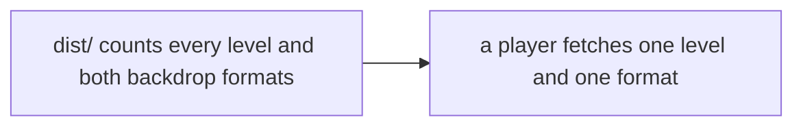

# Asset budget plan

Written for Andre. Measured on v2 commit `e9d3a81f453bc75a28806cc0684428ff25b6f4cc` (Phase 8.4, the tip when this plan was written). Caps were read from `tools/config.ts` and were not changed.

## Recommendation

Keep the current caps: **12 MB served** and **900 KB code**. The single-image cap stays 1.5 MB and the single-audio cap stays 6 MB. [PR #54](https://github.com/kzap/batoman-game/pull/54) would raise served to 20 MB. That alternative is not adopted. [Andre's decision on #53](https://github.com/kzap/batoman-game/issues/53#issuecomment-7055947438) is to compress and reuse first, and to raise a cap only inside a PR that has actually gone over, with the new number and the measured bytes on a named commit.

The compression step that fits the remaining levels is atlas WebP quality 90 (alpha quality 100, effort 6). On this build it removes **3,189,622 bytes** from the eight shipped atlases. Opaque-pixel color error (RMSE) is 2.4 to 5.4 levels out of 255. Alpha on the sheets that were checked stayed within 16 of the lossless mask.

With that setting, the planning stack below is **11,869,887 bytes**, which is **713,025 bytes under 12 MB**:

- Sigbin from [#45](https://github.com/kzap/batoman-game/pull/45), re-encoded at quality 90
- Tikbalang-X on the sheet already shipped (`tikbalang.webp`, 447,618 bytes)
- Manananggal-7 and Bakunawa each the size of that Sigbin sheet
- A Level 5 finale the size of Level 6's backdrops (both formats, because `dist/` counts both) and Level 6's prop sheet
- One new 60-second music cue at the current 80 kbps Opus setting

A second new cue of that length ([#50](https://github.com/kzap/batoman-game/issues/50)'s tower music) or a three-minute finale cue uses up the rest. Those are the points where reuse, a shorter loop, or a lower bitrate comes before a raise. The code cap has 54,945 bytes free after #40. Keep 900 KB.



## Caps against this build

`npm run budget` on `e9d3a81`:

| Cap | Ceiling | Measured | Headroom |
|---|---:|---:|---:|
| Served total, `dist/` minus source maps | 12,582,912 (12.00 MB) | 11,470,826 (10.94 MB) | 1,112,086 (1.06 MB) |
| Code, `.js` / `.mjs` / `.css` | 921,600 (900.0 KB) | 866,655 (846.3 KB) | 54,945 (53.7 KB) |
| Single image | 1,572,864 (1.50 MB) | 810,366 (`level-4-props.webp`) | 762,498 |
| Single audio | 6,291,456 (6.00 MB) | 2,008,819 (`level-1.ogg`) | 4,282,637 |

#40, which is this commit, added 6,058 code bytes over the previous tip (840.4 KB to 846.3 KB). That matches the +5.9 KB forecast quoted on #53. Served moved from 10.93 MB to 10.94 MB on the same delta. Source maps are 4,289,414 bytes and are excluded, same as `checkBudget`.

What the tools count: `tools/validate/budget.ts` walks `dist/` and calls `checkBudget`. Served is every file except `*.map`. Code is `.js`, `.mjs`, and `.css` inside that set. A single image over 1.5 MB or a single audio file over 6 MB fails on its own. The walk is the whole tree. It is not the first download, and it is not "the format this GPU chose."

## Where the 10.94 MB sits

| Category | Bytes |
|---|---:|
| Code (js, css) | 866,655 |
| KTX2 textures | 1,314,828 |
| WebP atlases | 4,841,994 |
| WebP backdrops | 1,200,282 |
| Basis transcoder wasm | 527,333 |
| Audio | 2,643,516 |
| Level JSON | 30,976 |
| HTML | 745 |
| Other (atlas JSON, backdrop meta, editor is in code) | 44,497 |
| Served total | 11,470,826 |

Top 15 served files:

| Bytes | File |
|---:|---|
| 2,008,819 | `assets/audio/level-1.ogg` |
| 810,366 | `assets/atlases/level-4-props.webp` |
| 787,854 | `assets/atlases/level-1-props.webp` |
| 650,920 | `assets/atlases/level-6-props.webp` |
| 637,160 | `assets/atlases/batoman.webp` |
| 634,697 | `assets/audio/level-2.ogg` |
| 568,310 | `assets/atlases/patroller.webp` |
| 559,581 | `assets/three-D2ziI635.js` |
| 527,333 | `assets/basis_transcoder-VXdx5NbI.wasm` |
| 509,300 | `assets/atlases/level-3-props.webp` |
| 447,618 | `assets/atlases/tikbalang.webp` |
| 430,466 | `assets/atlases/drone.webp` |
| 421,528 | `assets/backdrops/level-4/street.ktx2` |
| 386,766 | `assets/backdrops/level-6/garden.webp` |
| 230,166 | `assets/backdrops/level-1/town.webp` |

Atlases are the largest group, and they are lossless WebP today (`tools/pack/atlas.ts`). That is the compression target. Audio is two Opus files. The wasm blob is three's Basis transcoder, loaded only when a KTX2 is requested. It counts toward served, not toward the 900 KB code cap. The transcoder's JS wrapper does count as code.

## What a player downloads

`loadAssets` fetches Batoman, the current level's prop sheet, the enemy sheets that level spawns, and one backdrop format. Desktop GPUs that expose S3TC or BC7 get KTX2 plus the Basis wasm. Software GL (CI, SwiftShader, llvmpipe) gets WebP and skips the transcoder. Music starts when that track is played. Level JSON is one file. The editor chunk (29,927 bytes of js and css) loads only for `?edit=1`.

`npm run budget:report` on this build:

| Level | Desktop GPU (KTX2) | Software GL (WebP) |
|---|---:|---:|
| level-1 | 6,083,163 | 5,490,600 |
| level-3 (no `art` block, so no backdrops or props) | 3,658,600 | 3,053,438 |
| level-4 | 4,992,731 | 4,103,946 |
| level-6 | 6,464,929 | 6,039,192 |

Level 1 on a desktop GPU, which is the heavy cold load because it carries the 191-second track:

| Part | Bytes |
|---|---:|
| Shell (html, css, index js, three js) | 759,644 |
| Basis runtime (KTX2Loader js, transcoder js, wasm) | 605,162 |
| Batoman atlas | 646,002 |
| Drone, patroller, level-1 props | 1,803,278 |
| Sky + town KTX2, with meta | 253,788 |
| Level JSON | 6,470 |
| `level-1.ogg` | 2,008,819 |
| Total | 6,083,163 |

A full playthrough of the four levels on a desktop GPU, counting each shared file once, is **9,488,851 bytes**. The other **1,981,975 bytes** in `dist/` are the WebP backdrop fallback for every level (1,200,282), the Level 3 KTX2 files and prop sheet the grey-box level does not fetch (751,766), and the editor chunk (29,927). The Level 3 WebP copies sit inside the 1,200,282.

Both backdrop formats together are 2,515,110 bytes. A player pays for one of them. Gzip does not shrink WebP, KTX2, or Opus (a re-gzip of `level-1.ogg` was 2,008,628 bytes, and `tikbalang.webp` was 447,585). JS, CSS, and the wasm do shrink: the shell's JS/CSS/HTML gzip to about 200 KB (Vite's figures on this build), and the Basis runtime gzips to about 267 KB (wasm 245,406 of that). Level 1's wire size is about **5.2 MB**. At 10 Mbit/s that is about 4 seconds. At 1.6 Mbit/s it is about 26 seconds. At 40 Mbit/s it is about 1 second.

Raising the served cap does not change that wait. The cap is the hosted tree. Load time is the session above. Track the per-level number beside the total, with `npm run budget:report`. Keep the failing check on the total: that is what forces a decision when the tree grows. This plan does not add a second failing gate.

Level 3's nave, chapel, and prop sheet are already in the hosted tree (967,486 bytes including both formats and the atlas JSON). Wiring them into `level-3.json` does not add a second copy. Deleting them would only borrow room until that level is dressed.

## Incoming content

No Level 5 art, no Manananggal sheet, and no Bakunawa sheet exist. Each row cites a file this plan measured, or says it is an assumption.

| Item | Planning bytes | Basis |
|---|---:|---|
| Sigbin atlas, lossless, current packer | 885,342 | Packed from [#45](https://github.com/kzap/batoman-game/pull/45) at `4312b306` (`art/sigbin-boss`). 19 frames, 2048×1024. The PR's "864.6 KB" is this file. JSON is 3,846. |
| Sigbin atlas at WebP quality 90 | 625,920 | Same pixels, `quality: 90`, `alphaQuality: 100`, `effort: 6`. RMSE 3.98 on opaque pixels. |
| Sigbin telegraph | 7,882 | `sigbin-telegraph.wav` is 0.80 s, mono, 48 kHz. Opus 80 kbps, the music pipeline's setting. The PR's "7.7 KB" matches. |
| Level 3 props, #45 tileset | 406,372 lossless, 176,200 at q90 | Current shipped sheet is 509,300 (1024×1024, 23 frames). The #45 tileset repacks to 1024×512, 24 frames, including `footprint_back`. The canvas shrink is in that source, so the delta is real for #45 and is not a quality setting. |
| Tikbalang-X | 0 | The boss is the shipped mechanical horse. `tikbalang.webp` is already 447,618 bytes (30 frames, 1024×1024). A tint, if the fight wants one, is the path `aswang` already uses on the patroller sheet. |
| Manananggal-7 | 885,342 lossless, or 625,920 at q90 | No sheet. Sigbin is the half-screen boss baseline (19 frames, one body). High case 1.5× (1,328,013 lossless, 938,880 at q90) if whole, upper, and lower bodies do not share frames. `docs/ART.md`'s old 64×128 cell is retired for bosses by the half-screen rule. |
| Bakunawa | same sigbin-class number | No sheet. Planning uses one Sigbin-class atlas. Low case is the tikbalang sheet (447,618 lossless, 222,562 at q90) if the body is the tiled 96×96 segment `docs/ART.md` describes. High case is the same 1.5× as Manananggal. |
| Finale backdrops | 800,896 | No `art-source` finale folder. Level 6's pair, both formats, because the cap counts both: sky WebP 103,304 + KTX2 114,477, garden WebP 386,766 + KTX2 196,168, meta 181. Level 4's pair is 740,191 and Level 1's is 519,817. The story can reuse plates ("the rubble carries each place's light"); that case is 0 for backdrops, or one arena pair instead of a whole level. |
| Finale props | 655,532 lossless, or 210,244 at q90 | One new catalogue the size of `level-6-props` (650,920 + JSON 4,612). At quality 90 that sheet measures 205,632. |
| Finale music | 634,697 for 60 s, or 2,008,819 for 191 s | `level-2.ogg` is 60.02 s at 80 kbps Opus. `level-1.ogg` is 191.11 s at the same setting. [#51](https://github.com/kzap/batoman-game/issues/51) needs a new cue. The planning row is the one-minute loop. |
| Tower music (#50) | another 634,697 if it is also a 60 s cue | Not part of the finale. It spends the same cap. Shown separately so a second cue is visible. |
| Boss code | a few KB each | #40 measured +6,058 bytes. #41's +5.4 KB forecast on #53 was not rebuilt here: `art/sigbin-boss` does not merge cleanly onto this tip. Three later fights at that size are about 18 KB. |

#45's branch also carries the Sigbin fight. Its served total of 11.72 MB and code of 899.8 KB were measured before the #46 diet and before #40. They are not the numbers for this tip.

## Options, in the order to try them

### 1. Compression

**Atlas WebP quality 90 is the step that creates the room.** Every shipped atlas was decoded and re-encoded with sharp (`quality` 90 and 80, `alphaQuality` 100, `effort` 6). RMSE is the root mean square error of RGB on pixels whose alpha is at least 250.

| Atlas | Lossless | Quality 90 | RMSE 90 | Quality 80 | RMSE 80 |
|---|---:|---:|---:|---:|---:|
| drone | 430,466 | 224,482 | 3.80 | 188,466 | 6.00 |
| patroller | 568,310 | 248,008 | 3.38 | 197,312 | 5.58 |
| level-1-props | 787,854 | 173,796 | 2.39 | 120,542 | 4.46 |
| level-3-props | 509,300 | 130,534 | 3.93 | 82,878 | 6.11 |
| level-6-props | 650,920 | 205,632 | 5.02 | 151,158 | 6.46 |
| tikbalang | 447,618 | 222,562 | 3.47 | 183,268 | 5.69 |
| batoman | 637,160 | 211,186 | 5.40 | 153,924 | 7.22 |
| level-4-props | 810,366 | 236,172 | 3.10 | 179,512 | 4.41 |
| **Shipped total** | **4,841,994** | **1,652,372** | | **1,257,060** | |
| sigbin (incoming) | 885,342 | 625,920 | 3.98 | 531,184 | 6.04 |

Quality 90 saves **3,189,622 bytes** on the sheets already shipping. Quality 80 saves another 395,312 and the error climbs to 4.4–7.2. Sigbin from quality 70 to quality 60 only drops 16,776 bytes (487,004 to 470,228). Near-lossless at 80 was larger than quality 90 (sigbin 758,316, tikbalang 363,474).

On sigbin, tikbalang, batoman, level-4-props, and the #45 chapel props, a lossy re-encode at alpha quality 100 had zero pixels whose alpha moved by more than 16, and zero new fringe pixels above alpha 8, from quality 90 down through 60. The edge shape holds. The color does move, by the RMSE above. Batoman, the inkiest sheet, has the highest error. A painterly prop sheet hides it better than a hard outline. The art change that flips `writeAtlas` should look at Batoman and Sigbin at game scale before it lands. This plan does not change the encoder.

**Audio, second, and only for a new cue that is already long.** The pipeline is Opus in Ogg at 80 kbps (`tools/pack/audio.ts`). A re-encode of the same masters matches the shipped files (level-1 2,008,824 against 2,008,819, level-2 634,705 against 634,697).

| Setting | Level 1 (191.11 s, stereo) | Level 2 (60.02 s, stereo) | Sigbin cue (0.80 s) |
|---|---:|---:|---:|
| Opus 80 kbps, current | 2,008,824 | 634,705 | 7,882 |
| Opus 64 kbps | 1,600,374 | 506,977 | 6,299 |
| Opus 48 kbps | 1,196,559 | 379,519 | 4,877 |
| Opus 32 kbps | 800,959 | 255,599 | 3,387 |
| Opus 64 kbps mono | 1,580,626 | 498,172 | 6,299 |
| Opus 48 kbps mono | 1,189,080 | 373,547 | 4,877 |
| Vorbis 80 kbps | 1,797,948 | 590,498 | 8,608 |
| MP3 128 kbps | 3,058,380 | 960,970 | 13,868 |
| MP3 96 kbps | 2,293,836 | 720,778 | 10,412 |

Mono at a fixed bitrate saves almost nothing, because the bitrate is the total. It drops the stereo image and spends the same bits on one channel. Duration and bitrate are the levers. 80 kbps is the setting the pack comment calls no audible loss for this music. 64 kbps is a mild dulling. 48 kbps thins cymbals and noise and is a real cut on a three-minute piece. 32 kbps is for a short sting, not a level. MP3 at 128 kbps is larger than Opus at 80. Vorbis at 80 kbps was smaller (1,797,948 on the long track) and is not a reason to leave the codec the game already plays. Gzip does not shrink the Ogg files.

Keep the two shipped tracks at 80 kbps. Author the finale cue as a one-minute loop unless the scene needs the long form. Drop a long new cue to 64 kbps before touching the shipped tracks.

**KTX2 settings do not create this room.** Production is ETC1S quality 192, effort 1, no mipmaps, BasisLZ (`tools/pack/ktx2.ts`). Re-encoded from the same RGBA the packer feeds `level-4/street` (2816×1536, with alpha) and `level-1/sky` (1008×528, opaque):

| Encode | street | sky |
|---|---:|---:|
| ETC1S q192 effort 1, production | 421,528 | 67,205 |
| ETC1S q128 effort 1 | 318,442 | 47,113 |
| ETC1S q255 effort 1 | 456,599 | 74,326 |
| ETC1S q192 effort 6 | 426,398 (190 s) | 68,816 (17 s) |
| ETC1S q192 effort 1, mipmaps on | 540,116 | 87,033 |
| UASTC quality 2, Zstd off (scheme 0) | 4,325,568 | 532,416 |
| UASTC quality 2, Zstd on (scheme 2) | 2,945,036 | 451,506 |
| Half resolution, ETC1S q192 | 68,427 (1408×768) | 22,195 (504×264) |

Quality 128 saves 103,086 bytes on the biggest backdrop and 20,092 on the sky, and it is the layer that fills the screen. Effort 6 made the street file 4,870 bytes larger. Mipmaps add 118,588 bytes on the street, and backdrop sampling turns mipmaps off. UASTC is about ten times the ETC1S file. The encoder only offers UASTC for `data` and `normal` usage, which is linear rather than sRGB. Zstd writes supercompression scheme 2, which `npm run validate` rejects, and the production build stubs the Zstd decoder out of the code budget on purpose. Leave KTX2 where it is.

Street's WebP is already lossy (170,094 bytes at quality 90). Re-encoding it at quality 90 produced 161,906. Quality 80 produced 85,274. That is a smaller, more visible lever than the atlases, because this image covers the screen. Hold it.

### 2. Reuse

Tikbalang-X adds no texture. The sheet is in the tree.

The finale's rhyme with the docks, the chapel, the tower, and the garden can reuse those plates. Budgeting a full new Level 6 pair (800,896 bytes, both formats) is the case where the art is all new. Reusing the plates, and painting one arena pair only if the Pasig arena needs it, is the reuse step. It is worth about 0.8 MB, which is the difference between a one-minute cue fitting comfortably and a three-minute cue fitting at all.

Level 3's backdrops and props are already packed. #45 should wire them, not pack a second set. The footprint decal lands on that sheet (the repack measured above).

Sigbin's canvas is 46.2% covered and 83.1% fully clear, which is why the lossless file is 885 KB. The frames did not fit in 1024×1024, so the packer used 2048×1024. Sprite trimming is already what the packer does. A tighter pack is not a separate project. Quality 90 is what makes the empty texels cheap.

### 3. LOD, then the other levers

Far backdrops are already reduced (`farLodDimensions`). Level 1's sky ships at 1008×528. Mid layers are full resolution, and the street KTX2 at 421,528 bytes is the expensive one.

Half resolution on that street is 68,427 bytes of KTX2 and 62,338 bytes of quality-90 WebP. The save is real, and the mid layer is the one the player reads. Use it only if a measured build is still over after quality 90 and reuse. Do not halve boss sheets. Sigbin is packed at scale 0.5 and drawn near one screen pixel per atlas pixel. Another halving is a soft boss.

Dropping one backdrop format would remove either 1,200,282 bytes (WebP) or 1,314,828 bytes (KTX2) from the cap. WebP is the software-GL path CI runs. KTX2 is the GPU memory win the desktop path exists for. Leave both. The per-level report is how we stop confusing that double count with the player's wait.

Lazy loading does not shrink the cap. Levels are already fetched one at a time. The check sums the whole of `dist/`.

## Projected totals

Planning assumptions, stated above: two new bosses at the measured Sigbin size, Tikbalang-X at 0, a finale the size of Level 6, a 60-second cue, and #45's prop-sheet delta. JSON for a new boss sheet is counted as Sigbin's 3,846 bytes.

**Stay lossless.** Sigbin still fits. The next sheet does not.

| Step | Served bytes | Against 12,582,912 |
|---|---:|---|
| This build | 11,470,826 | under by 1,112,086 |
| + #45 (Sigbin 885,342 + JSON 3,846 + cue 7,882 − 102,928 props) | 12,264,968 | under by 317,944 |
| + Manananggal, sigbin-sized | 13,154,156 | over by 571,244 |
| + Bakunawa, sigbin-sized | 14,043,344 | over by 1,460,432 |
| + finale backdrops and props | 15,499,772 | over by 2,916,860 |
| + 60 s finale cue | 16,134,469 | over by 3,551,557 (15.39 MB) |
| Same stack, 191 s cue instead | 17,508,591 | over by 4,925,679 (16.70 MB) |

**Quality 90 on every atlas, including the new ones.** This is the path that stays under 12 MB.

| Piece | Bytes |
|---|---:|
| This build after the 3,189,622 byte atlas save | 8,281,204 |
| Sigbin q90 + JSON + telegraph | 637,648 |
| Level 3 props, q90 delta against today's q90 sheet | 45,666 |
| Manananggal q90 + JSON | 629,766 |
| Bakunawa q90 + JSON | 629,766 |
| Finale backdrops, Level 6 both formats | 800,896 |
| Finale props at the level-6 q90 size, plus JSON | 210,244 |
| Finale music, 60 s at 80 kbps | 634,697 |
| **Total** | **11,869,887** |
| Headroom under 12 MB | **713,025** |

Add a 1.5× Manananggal (the three body forms) and headroom falls to 400,065. Add a second 60-second cue for the tower and the total is 12,504,584, under by 78,328. That is inside the noise of a real encode. Treat a second full-length cue, or a 191-second finale cue (total 13,244,009, over by 661,097), as the moment to reuse backdrop plates or shorten the loop. A 191-second cue at 48 kbps is 1,196,559 instead of 2,008,819 and would scrape under. That is a worse trade than a one-minute loop at 80 kbps.

Code stays a separate column. 866,655 plus #41's forecast 5.4 KB plus about 18 KB for three later fights is still under 921,600, with roughly 30 KB left. A fight that imports a new runtime is the change that would spend it.

## Per-asset caps

They do not bind for this content. The served total does.

| Cap | Ceiling | Largest thing in the plan | Room |
|---|---:|---:|---:|
| Single image | 1,572,864 | Sigbin lossless 885,342. A 1.5× sheet is 1,328,013. | A sheet at 2× Sigbin (1,770,684) would fail this cap on its own. |
| Single audio | 6,291,456 | Level 1 at 80 kbps, 2,008,819. | A new track has to run about three times that length, near 9.5 minutes, to hit 6 MB. |
| Code | 921,600 | 866,655 today | 54,945, and the fights above fit in it. |

## When a later build would need a raise

Not this plan, and not up front. #54's 20 MB would cover the lossless stack (15.39 MB, or 16.70 MB with a long cue) with megabytes to spare. The decision is to compress first so that raise is unnecessary.

If a PR keeps lossless atlases and adds the next sigbin-sized sheet, the build above measures about **13.15 MB**. Propose **14 MB** in that PR. If one PR lands the whole uncompressed finale, propose **16 MB** for the one-minute cue (measured about 15.39 MB) or **18 MB** for the three-minute cue (measured about 16.70 MB). Use the `npm run budget` line from that commit if it disagrees with this table. The estimates move if a sheet is larger than Sigbin or a cue is longer than Level 1.

## How to raise a cap

Do it in the PR whose build is over, or in a dedicated PR that exists only to land that number. In `tools/config.ts`, change the one field, and in the comment name the new ceiling, the measured byte count, the full commit SHA `npm run budget` was run on, and the asset that pushed it over. Update the ceiling table in `docs/TDD.md` in the same PR. Leave the other three caps alone unless that same build broke one of them. A plan document is not the place the number changes.

## How to remeasure

From a clean checkout of the commit you care about:

```bash
git rev-parse HEAD
npm run assets
npx vite build
npm run budget
npm run budget:report
```

`npm run budget` is the gate (`tools/validate/budget.ts` → `checkBudget`). `npm run budget:report` prints the categories, the top 15, the two per-level columns, and each part. It reads the caps and does not change them. It fails only when `dist/` is missing.

The quality-90 numbers are sharp re-encodes of the packed WebP: `quality: 90`, `alphaQuality: 100`, `effort: 6`, RMSE on pixels with alpha at least 250. The KTX2 rows re-encode the RGBA `tools/pack/backdrops.ts` feeds the encoder, through `@babylonjs/ktx2encoder`, for `level-4/street` and `level-1/sky`. The audio rows are `ffmpeg-static` with `-c:a libopus -b:a <rate>k -vbr on` (and `-ac 1` for the mono rows) on `art-source/audio/level-1.mp3`, `level-2.mp3`, and the #45 telegraph wav. Sigbin was packed with the current `tools/pack` pipeline from the recipe and PNG on `origin/art/sigbin-boss` at `4312b306`.
