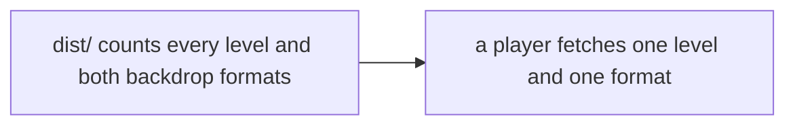

# Asset budget plan

Written for Andre. The served cap is **20 MB**, landed in [#54](https://github.com/kzap/batoman-game/pull/54) at `44c4288`. The code cap stays **900 KB**. This branch merges that tip. The byte counts below are from `npm run budget` after that merge, with [#41](https://github.com/kzap/batoman-game/pull/41) (the Sigbin fight) already on v2. The Sigbin sheet is not in the tree yet. `tools/config.ts` is v2's file; this plan does not edit it.

## Recommendation

Plan against **20 MB served** and **900 KB code**. The single-image cap stays 1.5 MB and the single-audio cap stays 6 MB. The full planned stack fits under 20 MB without changing how atlases are encoded.

| Stack | Served bytes | Headroom under 20,971,520 |
|---|---:|---:|
| Today, after #41 and #54 | 11,476,698 (10.95 MB) | 9,494,822 (9.05 MB) |
| Full stack, atlases left lossless | 16,577,348 (15.81 MB) | 4,394,172 (4.19 MB) |
| Full stack, atlases at WebP quality 90 | 13,091,736 (12.49 MB) | 7,879,784 (7.51 MB) |

The full stack is Sigbin from [#45](https://github.com/kzap/batoman-game/pull/45), Tikbalang-X at 0 bytes (the shipped horse sheet), Manananggal-7, Bakunawa counted at Sigbin's quality-90 size until a sheet exists, a finale the size of Level 6 (both backdrop formats plus the prop sheet), and a 90-second finale cue. L4 Tower Pulse (962 KB at 100 kbps) still fits on either row: lossless headroom stays about 3.27 MB, quality-90 headroom about 6.60 MB.

Quality 90 is optional. It is a load-time and download-size win, not a requirement to fit the cap. On the eight shipped atlases it removes **3,189,622 bytes** (3.04 MB). Sining (art and audio director) approved the call `.webp({ quality: 90, alphaQuality: 100, effort: 6 })` if that win is taken. Alpha is bit-exact on every sheet. Do not go below quality 90. Do not enable `sharp_yuv` globally (Batoman's max error goes from 71 to 126, and the drone RMSE gets worse). `smartSubsample` is optional on the Manananggal sheet only (+16 KB). `-exact` is unnecessary; frames already have a 1 px extrude. Her Manananggal sheet is **544 KB at quality 90** (1,005 KB lossless, RMSE 6.99, the weakest sheet, fine in play). Her 90-second finale cue is about **952 KB** at ~84 kbps VBR. A 60-second loop is the shipped Level 2 file, 634,697 bytes (~635 KB). The encoder change, if taken, is a separate PR on `infra/atlas-q90`.

Code is 872,480 bytes (852.0 KB). Headroom is 49,120 bytes (48.0 KB). #41 added 5,825 code bytes over the previous tip. Keep 900 KB.



## Caps against this build

`npm run budget` on this branch after merging `44c4288`:

| Cap | Ceiling | Measured | Headroom |
|---|---:|---:|---:|
| Served total, `dist/` minus source maps | 20,971,520 (20.00 MB) | 11,476,698 (10.95 MB) | 9,494,822 (9.05 MB) |
| Code, `.js` / `.mjs` / `.css` | 921,600 (900.0 KB) | 872,480 (852.0 KB) | 49,120 (48.0 KB) |
| Single image | 1,572,864 (1.50 MB) | 810,366 (`level-4-props.webp`) | 762,498 |
| Single audio | 6,291,456 (6.00 MB) | 2,008,819 (`level-1.ogg`) | 4,282,637 |

#54 raised `totalServed` to `20 * 1024 * 1024` and left the other three caps. #41, now on v2, added 5,825 code bytes over the 846.3 KB tip this plan first measured (866,655 to 872,480). Served moved from 11,470,826 to 11,476,698 on that code plus 47 bytes of level JSON. Source maps are excluded, same as `checkBudget`.

What the tools count: `tools/validate/budget.ts` walks `dist/` and calls `checkBudget`. Served is every file except `*.map`. Code is `.js`, `.mjs`, and `.css` inside that set. A single image over 1.5 MB or a single audio file over 6 MB fails on its own. The walk is the whole tree. It is not the first download, and it is not "the format this GPU chose."

## Where the 10.95 MB sits

| Category | Bytes |
|---|---:|
| Code (js, css) | 872,480 |
| KTX2 textures | 1,314,828 |
| WebP atlases | 4,841,994 |
| WebP backdrops | 1,200,282 |
| Basis transcoder wasm | 527,333 |
| Audio | 2,643,516 |
| Level JSON | 31,023 |
| HTML | 745 |
| Other (atlas JSON, backdrop meta, editor is in code) | 44,497 |
| Served total | 11,476,698 |

Top 15 served files:

| Bytes | File |
|---:|---|
| 2,008,819 | `assets/audio/level-1.ogg` |
| 810,366 | `assets/atlases/level-4-props.webp` |
| 787,854 | `assets/atlases/level-1-props.webp` |
| 650,920 | `assets/atlases/level-6-props.webp` |
| 637,160 | `assets/atlases/batoman.webp` |
| 634,697 | `assets/audio/level-2.ogg` |
| 568,310 | `assets/atlases/patroller.webp` |
| 559,581 | `assets/three-D2ziI635.js` |
| 527,333 | `assets/basis_transcoder-VXdx5NbI.wasm` |
| 509,300 | `assets/atlases/level-3-props.webp` |
| 447,618 | `assets/atlases/tikbalang.webp` |
| 430,466 | `assets/atlases/drone.webp` |
| 421,528 | `assets/backdrops/level-4/street.ktx2` |
| 386,766 | `assets/backdrops/level-6/garden.webp` |
| 230,166 | `assets/backdrops/level-1/town.webp` |

Atlases are the largest group, and they are lossless WebP today (`tools/pack/atlas.ts`). That is the compression target. Audio is two Opus files. The wasm blob is three's Basis transcoder, loaded only when a KTX2 is requested. It counts toward served, not toward the 900 KB code cap. The transcoder's JS wrapper does count as code.

## What a player downloads

`loadAssets` fetches Batoman, the current level's prop sheet, the enemy sheets that level spawns, and one backdrop format. Desktop GPUs that expose S3TC or BC7 get KTX2 plus the Basis wasm. Software GL (CI, SwiftShader, llvmpipe) gets WebP and skips the transcoder. Music starts when that track is played. Level JSON is one file. The editor chunk (29,927 bytes of js and css) loads only for `?edit=1`.

`npm run budget:report` on this build:

| Level | Desktop GPU (KTX2) | Software GL (WebP) |
|---|---:|---:|
| level-1 | 6,088,988 | 5,496,425 |
| level-3 (no `art` block; Sigbin reuses the patroller sheet) | 3,664,472 | 3,059,310 |
| level-4 | 4,998,556 | 4,109,771 |
| level-6 | 6,470,754 | 6,045,017 |

Level 1 on a desktop GPU, which is the heavy cold load because it carries the 191-second track:

| Part | Bytes |
|---|---:|
| Shell (html, css, index js, three js) | 765,469 |
| Basis runtime (KTX2Loader js, transcoder js, wasm) | 605,162 |
| Batoman atlas | 646,002 |
| Drone, patroller, level-1 props | 1,803,278 |
| Sky + town KTX2, with meta | 253,788 |
| Level JSON | 6,470 |
| `level-1.ogg` | 2,008,819 |
| Total | 6,088,988 |

A full playthrough of the four levels on a desktop GPU, counting each shared file once, is **9,494,723 bytes**. The other **1,981,975 bytes** in `dist/` are the WebP backdrop fallback for every level (1,200,282), the Level 3 KTX2 files and prop sheet the grey-box level does not fetch (751,766), and the editor chunk (29,927). The Level 3 WebP copies sit inside the 1,200,282. The Sigbin fight reuses the patroller sheet until #45's atlas lands, so that boss does not add a download of its own yet.

Both backdrop formats together are 2,515,110 bytes. A player pays for one of them. Gzip does not shrink WebP, KTX2, or Opus (a re-gzip of `level-1.ogg` was 2,008,628 bytes, and `tikbalang.webp` was 447,585). JS, CSS, and the wasm do shrink: the shell's JS/CSS/HTML gzip to about 200 KB (Vite's figures on this build), and the Basis runtime gzips to about 267 KB (wasm 245,406 of that). Level 1's wire size is about **5.2 MB**. At 10 Mbit/s that is about 4 seconds. At 1.6 Mbit/s it is about 26 seconds. At 40 Mbit/s it is about 1 second.

Raising the served cap does not change that wait. The cap is the hosted tree. Load time is the session above. Track the per-level number beside the total, with `npm run budget:report`. Keep the failing check on the total: that is what forces a decision when the tree grows. This plan does not add a second failing gate.

Level 3's nave, chapel, and prop sheet are already in the hosted tree (967,486 bytes including both formats and the atlas JSON). Wiring them into `level-3.json` does not add a second copy. Deleting them would only borrow room until that level is dressed.

## Incoming content

No Level 5 art, no Manananggal sheet, and no Bakunawa sheet exist. Each row cites a file this plan measured, or says it is an assumption.

| Item | Planning bytes | Basis |
|---|---:|---|
| Sigbin atlas, lossless, current packer | 885,342 | Packed from [#45](https://github.com/kzap/batoman-game/pull/45) at `4312b306` (`art/sigbin-boss`). 19 frames, 2048×1024. The PR's "864.6 KB" is this file. JSON is 3,846. |
| Sigbin atlas at WebP quality 90 | 625,920 | Same pixels, `quality: 90`, `alphaQuality: 100`, `effort: 6`. RMSE 3.98 on opaque pixels. |
| Sigbin telegraph | 7,882 | `sigbin-telegraph.wav` is 0.80 s, mono, 48 kHz. Opus 80 kbps, the music pipeline's setting. The PR's "7.7 KB" matches. |
| Level 3 props, #45 tileset | 406,372 lossless, 176,200 at q90 | Current shipped sheet is 509,300 (1024×1024, 23 frames). The #45 tileset repacks to 1024×512, 24 frames, including `footprint_back`. The canvas shrink is in that source, so the delta is real for #45 and is not a quality setting. |
| Tikbalang-X | 0 | The boss is the shipped mechanical horse. `tikbalang.webp` is already 447,618 bytes (30 frames, 1024×1024). A tint, if the fight wants one, is the path `aswang` already uses on the patroller sheet. |
| Manananggal-7 | 1,005,000 lossless, 544,000 at q90 | Art director's review. 1,005 KB lossless, 544 KB at quality 90, RMSE 6.99. Weakest sheet, fine in play. Larger than Sigbin when lossless (885,342), smaller once encoded at quality 90 (Sigbin q90 is 625,920). Kilobytes here are decimal, the same reading as her "~635 KB" for the 634,697-byte one-minute loop. |
| Bakunawa | 625,920 at q90 until a sheet exists | Still unpainted. Planning keeps Sigbin's quality-90 size (625,920 + 3,846 JSON). Her Manananggal result is the evidence a multi-form sheet can land nearer 544 KB. Low case remains the tikbalang sheet (222,562 at q90) if the body is the tiled 96×96 segment in `docs/ART.md`. |
| Finale backdrops | 800,896 | No `art-source` finale folder. Level 6's pair, both formats, because the cap counts both: sky WebP 103,304 + KTX2 114,477, garden WebP 386,766 + KTX2 196,168, meta 181. Level 4's pair is 740,191 and Level 1's is 519,817. The story can reuse plates ("the rubble carries each place's light"); that case is 0 for backdrops, or one arena pair instead of a whole level. |
| Finale props | 655,532 lossless, or 210,244 at q90 | One new catalogue the size of `level-6-props` (650,920 + JSON 4,612). At quality 90 that sheet measures 205,632. |
| Finale music | 952,046 for 90 s | Art director's cue: a 90-second loop, about 952 KB at ~84 kbps VBR. A 60-second loop is the shipped Level 2 size, 634,697 bytes (~635 KB). 952,046 is 90/60 of that file. Level 1 (191.11 s, 2,008,819) stays the long case. [#51](https://github.com/kzap/batoman-game/issues/51). |
| Tower music (#50) | 962,000 | Art director's L4 Tower Pulse: 962 KB at 100 kbps. Not in the finale stack. This is the track to shorten or bring down from 100 kbps if Bakunawa and the finale need the last 127 KB. |
| Boss code | a few KB each | #40 measured +6,058 bytes. #41's +5.4 KB forecast on #53 was not rebuilt here: `art/sigbin-boss` does not merge cleanly onto this tip. Three later fights at that size are about 18 KB. |

#45's branch also carries the Sigbin fight. Its served total of 11.72 MB and code of 899.8 KB were measured before the #46 diet and before #40. They are not the numbers for this tip.

## Options, in the order to try them

### 1. Compression

**Atlas WebP quality 90 is optional.** The cap no longer depends on it. It is the download and load-time win: 3,189,622 bytes off the eight shipped atlases, and smaller new sheets if `infra/atlas-q90` lands. Every shipped atlas was decoded and re-encoded with sharp (`quality` 90 and 80, `alphaQuality` 100, `effort` 6). RMSE is the root mean square error of RGB on pixels whose alpha is at least 250. A Level 1 desktop download that fetches batoman, drone, patroller, and the Level 1 props drops by 1,566,318 bytes of WebP at quality 90 (637,160→211,186, 430,466→224,482, 568,310→248,008, 787,854→173,796).

| Atlas | Lossless | Quality 90 | RMSE 90 | Quality 80 | RMSE 80 |
|---|---:|---:|---:|---:|---:|
| drone | 430,466 | 224,482 | 3.80 | 188,466 | 6.00 |
| patroller | 568,310 | 248,008 | 3.38 | 197,312 | 5.58 |
| level-1-props | 787,854 | 173,796 | 2.39 | 120,542 | 4.46 |
| level-3-props | 509,300 | 130,534 | 3.93 | 82,878 | 6.11 |
| level-6-props | 650,920 | 205,632 | 5.02 | 151,158 | 6.46 |
| tikbalang | 447,618 | 222,562 | 3.47 | 183,268 | 5.69 |
| batoman | 637,160 | 211,186 | 5.40 | 153,924 | 7.22 |
| level-4-props | 810,366 | 236,172 | 3.10 | 179,512 | 4.41 |
| **Shipped total** | **4,841,994** | **1,652,372** | | **1,257,060** | |
| sigbin (incoming) | 885,342 | 625,920 | 3.98 | 531,184 | 6.04 |

Quality 90 saves **3,189,622 bytes** on the sheets already shipping. Quality 80 saves another 395,312 and the error climbs to 4.4–7.2. Sigbin from quality 70 to quality 60 only drops 16,776 bytes (487,004 to 470,228). Near-lossless at 80 was larger than quality 90 (sigbin 758,316, tikbalang 363,474). Those lower settings stay in the table as measurements. The art director's floor is quality 90. Do not ship below it.

Her review of the same encoder call, `.webp({ quality: 90, alphaQuality: 100, effort: 6 })`:

- Alpha is bit-exact on every sheet. This plan's earlier check (no pixel moved by more than 16, on sigbin, tikbalang, batoman, level-4-props, and the #45 chapel props) was the weaker test. Her pass is the one to use.
- Do not turn on `sharp_yuv` for the whole pipeline. Batoman's max error goes from 71 to 126, and the drone RMSE gets worse.
- `smartSubsample` is optional on the Manananggal sheet only. It costs about 16 KB on that file. Leave it off everywhere else.
- `-exact` is not needed. `tools/pack/atlas.ts` already extrudes each frame by 1 pixel.

Color still moves by the RMSE above. Manananggal is the weakest of the set at RMSE 6.99, and she judged it fine in play. Batoman, at 5.40 on this plan's re-encode, is the inkiest sheet already shipping. The implementation PR (`infra/atlas-q90`) is where `writeAtlas` changes. This document does not change it.

**Audio, second, and only for a new cue that is already long.** The pipeline is Opus in Ogg at 80 kbps (`tools/pack/audio.ts`). A re-encode of the same masters matches the shipped files (level-1 2,008,824 against 2,008,819, level-2 634,705 against 634,697).

| Setting | Level 1 (191.11 s, stereo) | Level 2 (60.02 s, stereo) | Sigbin cue (0.80 s) |
|---|---:|---:|---:|
| Opus 80 kbps, current | 2,008,824 | 634,705 | 7,882 |
| Opus 64 kbps | 1,600,374 | 506,977 | 6,299 |
| Opus 48 kbps | 1,196,559 | 379,519 | 4,877 |
| Opus 32 kbps | 800,959 | 255,599 | 3,387 |
| Opus 64 kbps mono | 1,580,626 | 498,172 | 6,299 |
| Opus 48 kbps mono | 1,189,080 | 373,547 | 4,877 |
| Vorbis 80 kbps | 1,797,948 | 590,498 | 8,608 |
| MP3 128 kbps | 3,058,380 | 960,970 | 13,868 |
| MP3 96 kbps | 2,293,836 | 720,778 | 10,412 |

Mono at a fixed bitrate saves almost nothing, because the bitrate is the total. It drops the stereo image and spends the same bits on one channel. Duration and bitrate are the levers. 80 kbps is the setting the pack comment calls no audible loss for this music. 64 kbps is a mild dulling. 48 kbps thins cymbals and noise and is a real cut on a three-minute piece. 32 kbps is for a short sting, not a level. MP3 at 128 kbps is larger than Opus at 80. Vorbis at 80 kbps was smaller (1,797,948 on the long track) and is not a reason to leave the codec the game already plays. Gzip does not shrink the Ogg files.

Keep the two shipped tracks at 80 kbps. The finale cue is a 90-second loop at about 84 kbps VBR, ~952 KB, which is 90/60 of the 634,697-byte Level 2 file. L4 Tower Pulse is the separate cue at 962 KB and 100 kbps. That higher bitrate is what comes down first if the cap gets tight. Do not cut the shipped tracks to make room for it.

**KTX2 settings do not create this room.** Production is ETC1S quality 192, effort 1, no mipmaps, BasisLZ (`tools/pack/ktx2.ts`). Re-encoded from the same RGBA the packer feeds `level-4/street` (2816×1536, with alpha) and `level-1/sky` (1008×528, opaque):

| Encode | street | sky |
|---|---:|---:|
| ETC1S q192 effort 1, production | 421,528 | 67,205 |
| ETC1S q128 effort 1 | 318,442 | 47,113 |
| ETC1S q255 effort 1 | 456,599 | 74,326 |
| ETC1S q192 effort 6 | 426,398 (190 s) | 68,816 (17 s) |
| ETC1S q192 effort 1, mipmaps on | 540,116 | 87,033 |
| UASTC quality 2, Zstd off (scheme 0) | 4,325,568 | 532,416 |
| UASTC quality 2, Zstd on (scheme 2) | 2,945,036 | 451,506 |
| Half resolution, ETC1S q192 | 68,427 (1408×768) | 22,195 (504×264) |

Quality 128 saves 103,086 bytes on the biggest backdrop and 20,092 on the sky, and it is the layer that fills the screen. Effort 6 made the street file 4,870 bytes larger. Mipmaps add 118,588 bytes on the street, and backdrop sampling turns mipmaps off. UASTC is about ten times the ETC1S file. The encoder only offers UASTC for `data` and `normal` usage, which is linear rather than sRGB. Zstd writes supercompression scheme 2, which `npm run validate` rejects, and the production build stubs the Zstd decoder out of the code budget on purpose. Leave KTX2 where it is.

Street's WebP is already lossy (170,094 bytes at quality 90). Re-encoding it at quality 90 produced 161,906. Quality 80 produced 85,274. That is a smaller, more visible lever than the atlases, because this image covers the screen. Hold it.

### 2. Reuse

Tikbalang-X adds no texture. The sheet is in the tree.

The finale's rhyme with the docks, the chapel, the tower, and the garden can reuse those plates. Budgeting a full new Level 6 pair (800,896 bytes, both formats) is the case where the art is all new. Reusing the plates, and painting one arena pair only if the Pasig arena needs it, gives back that 800,896. Under the 20 MB cap that save is extra headroom, not a requirement.

Level 3's backdrops and props are already packed. #45 should wire them, not pack a second set. The footprint decal lands on that sheet (the repack measured above).

Sigbin's canvas is 46.2% covered and 83.1% fully clear, which is why the lossless file is 885 KB. The frames did not fit in 1024×1024, so the packer used 2048×1024. Sprite trimming is already what the packer does. A tighter pack is not a separate project. Quality 90 is what makes the empty texels cheap.

### 3. LOD, then the other levers

Far backdrops are already reduced (`farLodDimensions`). Level 1's sky ships at 1008×528. Mid layers are full resolution, and the street KTX2 at 421,528 bytes is the expensive one.

Half resolution on that street is 68,427 bytes of KTX2 and 62,338 bytes of quality-90 WebP. The save is real, and the mid layer is the one the player reads. Use it only if a measured build is still over after quality 90 and reuse. Do not halve boss sheets. Sigbin is packed at scale 0.5 and drawn near one screen pixel per atlas pixel. Another halving is a soft boss.

Dropping one backdrop format would remove either 1,200,282 bytes (WebP) or 1,314,828 bytes (KTX2) from the cap. WebP is the software-GL path CI runs. KTX2 is the GPU memory win the desktop path exists for. Leave both. The per-level report is how we stop confusing that double count with the player's wait.

Lazy loading does not shrink the cap. Levels are already fetched one at a time. The check sums the whole of `dist/`.

## Projected totals

Planning assumptions, stated above. The baseline is this branch after #41 and #54: 11,476,698 bytes, 5,872 more than the first measurement on `e9d3a81` (5,825 of code, 47 of level JSON). Every later row includes that. Manananggal's sizes are the art director's. Bakunawa is still Sigbin's quality-90 size until a sheet exists. The finale cue is 90 seconds. JSON for an unpainted boss sheet is Sigbin's 3,846 bytes. Her 544 KB and 1,005 KB are decimal kilobytes (544,000 and 1,005,000), matching "~635 KB" for the 634,697-byte one-minute loop. The ceiling in both tables is 20,971,520.

**Lossless atlases, the path that already fits.**

| Step | Served bytes | Headroom under 20 MB |
|---|---:|---:|
| This build | 11,476,698 | 9,494,822 |
| + #45 (Sigbin 885,342 + JSON 3,846 + cue 7,882 − 102,928 props) | 12,270,840 | 8,700,680 |
| + Manananggal lossless 1,005,000 + JSON 3,846 | 13,279,686 | 7,691,834 |
| + Bakunawa, Sigbin lossless + JSON | 14,168,874 | 6,802,646 |
| + finale backdrops and props | 15,625,302 | 5,346,218 |
| + 90 s finale cue (952,046) | 16,577,348 | 4,394,172 (4.19 MB) |
| Same stack, 191 s cue instead | 17,634,121 | 3,337,399 (3.18 MB) |
| 90 s stack plus Tower Pulse (962,000) | 17,539,348 | 3,432,172 (3.27 MB) |

**Quality 90, the optional smaller tree.** Her review put an earlier v2, plus #45, plus Manananggal, all at quality 90, at 10.01 MB (10,492,912 bytes, which was 2.09 MB under the old 12 MB cap). This branch is 5,872 bytes heavier, so that subtotal is 10,498,784. The rows under it are this plan's additions. Headroom is against 20 MB.

| Piece | Bytes | Running total | Headroom |
|---|---:|---:|---:|
| v2 + #45 + Manananggal, all q90, plus #41's 5,872 bytes | 10,498,784 | 10,498,784 | 10,472,736 |
| Finale music, 90 s at ~84 kbps (952,046) | 952,046 | 11,450,830 | 9,520,690 |
| Finale backdrops, Level 6 both formats | 800,896 | 12,251,726 | 8,719,794 |
| Finale props at the level-6 q90 size, plus JSON | 210,244 | 12,461,970 | 8,509,550 |
| Bakunawa at Sigbin q90 + JSON | 629,766 | 13,091,736 | 7,879,784 (7.51 MB) |
| Tower Pulse, 962 KB at 100 kbps | 962,000 | 14,053,736 | 6,917,784 (6.60 MB) |

Both full stacks fit. Quality 90 leaves 7,879,784 bytes instead of 4,394,172, a 3,485,612 byte difference on the whole plan, of which 3,189,622 is the measured save on the eight atlases already shipping. `smartSubsample` on Manananggal only moves her sheet by about 16 KB.

Code stays a separate column. 872,480 bytes are in the tree. About 48 KB remains under 900 KB. A fight that imports a new runtime is the change that would spend it.

## Per-asset caps

They do not bind for this content. The served total does.

| Cap | Ceiling | Largest thing in the plan | Room |
|---|---:|---:|---:|
| Single image | 1,572,864 | Manananggal lossless, her 1,005 KB (1,005,000). Sigbin lossless is 885,342. | Both clear 1.5 MB. A sheet at 2× Sigbin (1,770,684) would fail this cap on its own. |
| Single audio | 6,291,456 | Level 1 at 80 kbps, 2,008,819. The 90 s finale cue is ~952 KB. Tower Pulse is 962 KB. | A new track has to run about three times Level 1, near 9.5 minutes, to hit 6 MB. |
| Code | 921,600 | 872,480 today | 49,120. A later fight that stays the size of #41 fits. |

## Headroom, and a later raise

The full planned stack fits under 20 MB. Lossless leaves 4,394,172 bytes. Quality 90 leaves 7,879,784. Tower Pulse on top of either still leaves more than 3 MB. No further raise is in this plan.

If a later build does exceed 20 MB, raise `totalServed` in that PR, or in a dedicated PR that exists only to land the number. In `tools/config.ts`, change the one field, and in the comment name the new ceiling, the measured byte count, the full commit SHA `npm run budget` was run on, and the asset that pushed it over. Update the ceiling table in `docs/TDD.md` in the same PR. Leave the other three caps alone unless that same build broke one of them. #54 is the example: it moved the cap to 20 MB at `44c4288` and left code at 900 KB.

## How to remeasure

From a clean checkout of the commit you care about:

```bash
git rev-parse HEAD
npm run assets
npx vite build
npm run budget
npm run budget:report
```

`npm run budget` is the gate (`tools/validate/budget.ts` → `checkBudget`). `npm run budget:report` prints the categories, the top 15, the two per-level columns, and each part. It reads the caps and does not change them. It fails only when `dist/` is missing.

The quality-90 numbers are sharp re-encodes of the packed WebP: `quality: 90`, `alphaQuality: 100`, `effort: 6`, RMSE on pixels with alpha at least 250. The KTX2 rows re-encode the RGBA `tools/pack/backdrops.ts` feeds the encoder, through `@babylonjs/ktx2encoder`, for `level-4/street` and `level-1/sky`. The audio rows are `ffmpeg-static` with `-c:a libopus -b:a <rate>k -vbr on` (and `-ac 1` for the mono rows) on `art-source/audio/level-1.mp3`, `level-2.mp3`, and the #45 telegraph wav. Sigbin was packed with the current `tools/pack` pipeline from the recipe and PNG on `origin/art/sigbin-boss` at `4312b306`.
